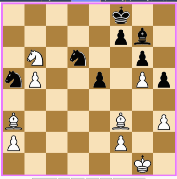
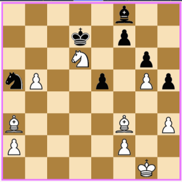

[Download the newsletter as a PDF](/assets/newsletter/club-newsletter-no-20-march-2022.pdf) (it has the photos and diagrams that are not on this page).

*Chess out of lockdown – at last? Streatham and Brixton Chess Club’s post COVID pick me up. Back over the board, please pay to play! – Our online tourney – Online and OTB round up – Ukraine – Moved and Taken – London Chess Community – County chess*

### Over the Board, Over the Moon – and Subs Time Again!

After 150 years and a pandemic we are back OTB again! All the **Over The Board leagues** are up and running - and the full Streatham and Brixton OTB offer is now available again to our members – and more! So, now, after a subs moratorium we need your support once more. **Please pay to play!**

Our middle/entry level 4-board team in **Division 3 of the Central London Chess League** ([CLCL](https://www.oxfordfusion.com/oca/GenerateTable.cfm?LeagueID=427&Org=7)) has battled through since the Autumn, with 2 matches to go. Our teams in the **London Chess League** ([LCL](https://londonchess.com/)) Division 1 (top strength – 8 boards) and Major Division (middle strength – 4 bds) are now engaged again after a pause in January. In the **Surrey League** ([SL](https://www.scca.co.uk/index.html)) our team in the strong Division 2 (7-boards) is fighting hard. The **Croydon and District Chess League** ([CDCL](https://lms.englishchess.org.uk/lms/organisation/1250)) is just about to burst into life again with three S&BCC teams (all 4-boards), in the very strong Division 1, the entry-level Division 4, and the fun Rapid-play Division. By the way, our Surrey League affiliation opens the door for you to play in year-round County sides, and in individual tournaments that run on into the summer (see more at end).

But that’s not all! We are still online in the **Online 4 Nations Chess League** ([OL4NCL](https://www.4ncl.co.uk/data/onlines5/online_results_5.htm)), with three 4-bd teams (in the seriously-strong Division 1, plus Divisions 4 and 5 for up and coming players); member James Toon is running a rated online **club tournament** (see [here](https://chess-results.com/tnr605739.aspx?lan=1&art=2&rd=4&turdet=YES)) at a classic time control. And if social chess is your thing, then our drop-in **social chess group** at Streatham Library on Tuesday afternoons is as popular as ever (see [here](https://sites.google.com/site/chessatstreathamlibrary/)).

We run on a shoe-string budget, and **you get all this for a mere £45 per annum** (or £22.50 new members, and concessions; or £4.50 game fee).

This covers our League affiliation, board, and home match venue fees – and the other costs of running our club. We are one of the cheapest going. All our officers and team captains are unpaid volunteers. But we always appeal to our financially stable members to **donate more.** And we appeal to everyone to pay promptly – otherwise someone has to spend their own time chasing you!

**Here’s how to do it: Please make your payment into the club’s bank account, using your name as a reference** (the account name is Streatham & Brixton Chess Club at Santander; the account number and sort code are in the PDF newsletter).

### S&BCC Online Tournament

Big thanks to member James Toon (he has been in playing for the club, on and off, for ages) for organising an **online rated tournament** (45m +15spm) for club members. Twelve of S&BCC’s finest have been battling it out – now onto round 5 out of 7. Played on Chess.com, you can follow it - round by round - [here](https://chess-results.com/tnr605739.aspx?lan=1&art=4&turdet=YES). As we go to press, James, John Hodgson and Rupert Dickens are ahead of the chasing pack. All the game scores are online for your perusal, including an amusing joust of pins and counter-pins at the conclusion of [John’s game against Angus French in round 2](https://chess-results.com/partieSuche.aspx?lan=1&art=4&tnr=605739&rd=2).

In the diagram below left, White (John) has just played **29. Ba3 (pin!).** Next there was 29 …Ke7 30. Nc8+ (fork!) Kd7 31. Nxd6, and then, in the diagram below right, Black (Angus) played 31…Bf8 (counterpin!)

<figure style="margin: 15px 0; clear: both;">

<figcaption><i>What was White’s 32nd – a neat unpin?</i></figcaption>
</figure>

Impressive was [Rupert’s model Catalan Gambit victory](https://chess-results.com/partieSuche.aspx?lan=1&art=4&tnr=605739&rd=2) (also in Round 2) over Matt Grace (we hope neither Matt nor Rupert will mind if we draw attention to it). If anyone wanted an advert for the Catalan here it is: gambit the c4 pawn, build a big centre…



and follow up with a d5 push (White’s 14th) and a passed pawn running home supported by a white-squared Catalan Bishop reigning supreme. This particular line – with the WN going to c3 (Nd2 is preferred these days) - goes back to Botvinnik before WW2, and was later picked up by Topalov in the 1990s. However, [Vladimir Kramnik demonstrated the antidote in 1997](https://www.youtube.com/watch?v=hrYxfmBFbzg), (with an early …e5), and Nc3 gambit Catalan fell out of favour at GM level. But don’t let that put you off playing the opening! The Catalan offers strategic clarity (see the games of Ulf Anderssen, for example [this one](https://www.chessgames.com/perl/chessgame?gid=1020655)) or tactical complexity (as shown by Alexander Khalifman, [here](https://www.chessgames.com/perl/chessgame?gid=1398688)) in different games - and sometimes in the same one (Magnus Carlsen!).

### S&BCC Over the Board and Online

#### Surrey League

**Beaumont Cup, 7 boards (Captain Martin Smith).** Our team in the second Division (the Beaumont Cup) has 1.5/3 match points. In our drawn match v Surbiton 2 on 1 March we were delighted to field 2 newcomers: Aivar Jefrymov (who won an exemplary positional game (a Catalan!) - see it [here](https://lichess.org/study/bmNtyGXu) - and Sam Durno (both very welcome!). We have two more fixtures, both at our temporary venue West Thornton Community Centre: Tuesday 5 April v South Norwood, and Tuesday 12 April v Epsom. We must win both to come 2nd in the Division (see [here](https://www.scca.co.uk/comps/comps_index.html) under Beaumont Cup).



#### London League

**First team – Division 1 East, 8 boards (Captain Liam Hylands).** After losing the obligatory GM masterclass to Wood Green, we won our two most recent matches (both 5 v 3: against Athenaeum and Lewisham) – and were pleased to see some old faces returning to OTB play. Welcome back guys! Next match: 21 April v Cavendish (at their venue). Following a League Committee meeting on 9 March we are expecting them to publish revised COVID.

**Second team – Major East, 4 boards (Captain Paul Ritchie).** Our 4-board team in the Major league is undefeated after 3 matches, having drawn 2 and won 1. We sit second in the league with everything to play for! **Next dates: 23 March, and 1 April.**

#### Croydon League

**All matches 4 boards.** The season is about to kick off after the Lockdown hibernation. See the League’s new website [here](https://lms.englishchess.org.uk/lms/organisation/1250). For our fixture dates see our [online club calendar](/calendar/). Our **A team (captain Martin Smith)** will be in the strong Open Division, lining up against Lewisham, Petts Wood, and West Wickham in a double rounder. Very challenging! Our **D team in Division 4** (total grade limit 5800) will be up against Crystal Palace, Lewisham, South Norwood and West Wickham (also a double rounder). We hope Library players will support this team – **captain Richard Tillett.** For a bit of fun we will play in the **Rapidplay Division** (2 x 25 minute games – total grade limit 7800) against Lewisham and Petts Wood (double round, **captain Martin Smith).** **Upcoming fixtures are:** A away v West Wickham 30 March; D away at Crystal Palace 21 March; Rapid home v Lewisham 26 April.

#### Central London Chess League

**Division 3, 4 boards (Captain Paul Ritchie).** Paul Ritchie’s team – playing at this League’s venue at Pimlico – has two matches left this season, both against Hammersmith 2. Wins would enable us to sneak a top 3 spot in the division despite lingering near the bottom for most of the season. **Up next: 24 March v Hammersmith 2.**

#### Online 4NCL

John Hodgson and Liam Hylands have worked wonders managing our three teams in the [Online 4NCL](https://www.4ncl.co.uk/data/onlines5/online_results_5.htm) – organising 12 boards on a fortnightly Tuesday evening schedule. After the fourth round on 8 March, the **first team** sits 4th/8 in its group having won two matches, lost one, and drawn the fourth (in bizarre circumstances after Liam’s lost game was voided – his opponent didn’t click ‘rated’ on Lichess; so 1.5 v 1.5 and a draw!). Our **B team** is heading up its group in Division 4 after a nice 3 v 1 win on March 8; and our **C team** (Division 5) has at last broken its duck, thanks to a 4-0 walkover! All teams have three more rounds to go (and maybe then inter-group play-offs, if successful). Check out John Bennett’s crisp board 1 win ([here](https://lichess.org/study/bmNtyGXu)) for the A team in the last round. (BTW John now lives in Hastings, and so would need overnight accommodation on match nights to enable him to play OTB in the Surrey and Croydon Leagues – please can any member help?)



### Ukraine and Chess

We hope we speak for all club members in expressing shock and disgust at the Russian invasion of Ukraine. The international chess community has responded with FIDE condemning ‘the use of military means to resolve political conflicts’ (full statement [here](https://fide.com/news/1603)). It has taken sanctions against Russian representative chess, and against Anatoly Karpov who is a member of the Russian Duma. Meanwhile 44 Russian GMs have written an open letter of protest to the Russian authorities. Sadly 2016 World Champ challenger GM Sergey Karjakin is not one of them and has attracted disdain on social media for his distasteful support for the invasion.

Here is the English Chess Federation’s statement of 28 February:

> The English Chess Federation (ECF) agrees with FIDE Council’s recently announced decision that the 44th Chess Olympiad, including the competition for players with disabilities, as well as the FIDE Congress, will no take place in Russia ([https://www.fide.com/news/1598](https://www.fide.com/news/1598)). The ECF wishes FIDE well in its attempts to find another organizer for the Olympiad.
>
> The ECF would like to add that:
>
> 1. In its view FIDE should hold no further events in Russia until Russia has fully withdrawn from Ukrainian sovereign territory and ends hostilities against the Ukrainian people.
> 2. It will not send teams, players or officials to any chess events held in Russia until Russia has fully withdrawn from Ukrainian sovereign territory and ends hostilities against the Ukrainian people.
> 3. In its view FIDE should terminate all agreements with Russian sponsors with immediate effect.
>
> Mike Truran, Chief Executive ECF | Malcolm Pein, FIDE Delegate and International Director ECF

It was updated on the 6 March as follows:

> The ECF Board confirms that individual players and officials with a Russian or Belarusian FIDE registration will be excluded from all ECF-organised competitions until further notice. The ECF Board urges all organisers of events held in England to adopt the same approach. Please also see the European Chess Union’s statement following its meeting in extraordinary session on 3 March here – [https://www.europechess.org/ecu-suspends-the-russian-and-belarusian-chess-federations/](https://www.europechess.org/ecu-suspends-the-russian-and-belarusian-chess-federations/)

Lichess, where we play so much online chess, has made a measured statement on Ukraine and Russian players [here.](https://lichess.org/blog/Yie1MhIAACAAk6OQ/lichess-statement-on-the-war-in-ukraine) Meanwhile [Chess.com](https://www.chess.com/news/view/ukrainian-chess-players-in-times-of-war) has an ongoing thread reporting on Ukrainian players, and the chess-world’s response to the invasion.

As a gesture of solidarity with Ukraine - even if only symbolic – we present [here](https://www.chessgames.com/perl/chessgame?gid=1406152) a fantastic game by that flawed genius Ukrainian GM Vasyl Ivanchuk. It was against Bulgarian Veselin Topalov in 1999, in happier times. (There are also some YouTube presentations of it.) We would like to hope that Ivanchuk’s demolition of his opponent might be the fate that befalls the Russian forces invading Ukraine.



Some of you will know that club member Kostya is Ukrainian by birth – we talked to him about it in Lockdown Magazine #4 (two years ago!) – and has family in Ukraine.

After some anxious moments whether Kostya might be caught up in the conflict, we have since heard from him a couple of times: most recently 12 March:

“Everyone from our families are safe, some are in Munich, Germany waiting to get a UK visa and some are in western Ukraine in Volyn Oblast, where there is no active fighting. My family fled Kharkiv and Olga's [Kostya’s wife] family fled Vorzel, Kyiv Oblast - in or around these places there was (and still is) fierce fighting. If anyone wants to help please take a look at [https://www.gov.uk/government/news/ukraine-what-you-can-do-to-help](https://www.gov.uk/government/news/ukraine-what-you-can-do-to-help) or directly donate to Ukrainian army here [https://war.ukraine.ua/donate/](https://war.ukraine.ua/donate/). Many thanks for your support.”

We should also mention our friend Jo Ostrowska who has been at the [Polish White Eagle Club](https://www.facebook.com/kluborlabialego) in Balham helping to organise donations for the victims of the Russian aggression.

### Moved and Taken for 150 Years – But Our Anniversary Continues!



In this Magazine issue we have been talking about everything the club has to offer, so let’s also mention **Movers and Takers – a chess history of Streatham 1871-2021.** It’s available to members at the bargain price of £10.00; a snip that won’t be repeated for another 150 years.

And continuing, as we now are, unashamedly to blow our own trumpet, here is what Danny Rosenbaum, the editor of the ECF’s members’ newsletter *Chess Moves*, said in their January issue: *[Movers and Takers] is a delight. Every page has some snippet of interest, and the book is packed full of photos that bring a smile to the face. I hope the author won’t mind me saying that it is the sort of book that you can enjoy dipping in and out of.* [No, Danny, we don’t mind at all!]

And our good friend, and renowned chess historian and author, Richard James had these kind words in the online [British Chess News](https://britishchessnews.com/2022/01/14/movers-and-takers-a-chess-history-of-streatham-and-brixton-1871-2021/#:~:text=Movers%20and%20Takers%20is%20the,chess%20in%20the%20expanding%20suburbs.) of January 2022: *“[It] does an excellent job of placing the club within its local community… There’s also a lot about the girls and women who played chess in the area: there were a surprising number …strongly recommended for anyone with any interest at all in the history of British – and London – chess over the past 150 years.”* [Thanks Richard!].

We must also mention our friends at the Streatham Society, who helped us publish the book. They gave it a full-page plug (p30) in the latest issue of their *Streatham Society News*, and featured us on the front page celebrating our 150th at the Rookery Market back in October. Thanks to all club members who supported us at that event (we should do it again, shouldn’t we?) – and the Streatham Society for the coverage!

We will have copies in all Lambeth’s libraries soon… helping to put S&BCC on the local map. But rather than borrow one from the library, why not order your own personal copy while stocks last? Message me quick!



And in case you were wondering: our 150th celebrations are not over yet! COVID permitting, we plan to run our delayed **Anniversary Open Rapidplay** sometime in the summer.

We need you to help us repeat the success of the last one - at the Library in 2014 (*right*).

### London Chess Community

The March issue of *Chess* magazine has a great report of the new post-COVID/Queen’s Gambit/online-going-OTB chess phenomenon: the **‘London Chess Community’.** Drop-in to a friendly venue, where there is no fee, no rules, and a ‘just-play-for-fun’ ethos.

We could mention, though, that the **Streatham Library group** was there first, and we have been in contact with **OTB Southbank,** and there is every chance of some useful cross fertilisation.

So if you fancy it, wrap up warm, and hot foot it to the Southbank on a Sunday afternoon.

### County Chess

If you are at a loss for what to do on a *Saturday* afternoon, why not **play a game for Surrey County?** Home matches are in Cheam, away in south-east county venues (car sharing usually available). There is a relaxed rate of play in a friendly, but competitive atmosphere.

Teams at all levels (Open; U2025; U1850, U1650, U1450). Several of our club members are regulars – why not join them? County team captains are listed on the [SCCA website](https://www.scca.co.uk/index.html) (under Officers): they’d love to hear from you!

And now it also the time to register for the county’s individual tournaments. They run into the summer. There are 4 competitions organised by playing strength, offered at various venues including Wimbledon and Thornton Heath. Details also on the [SCCA website](https://www.scca.co.uk/index.html) (see News).

*Editorial contact: Martin Smith (contact details are in the PDF newsletter). Follow the club on [Twitter](https://twitter.com/Streathamchess) and at [streathamchess.org](https://streathamchess.org/).*
