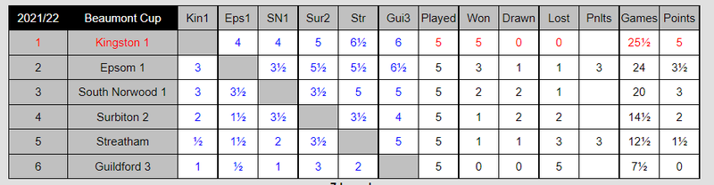
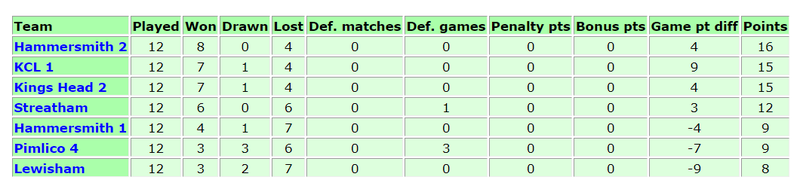
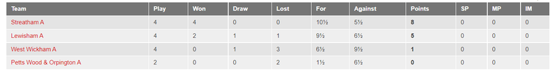

[Download the newsletter as a PDF](/assets/newsletter/club-newsletter-no-21-june-2022.pdf) (it has the photos and diagrams that are not on this page).

*S&BCC – Back to the mainline. Anniversary Rapid – the Library Group – Results 1 to 3 – Goodbye Liam – Moved and Taken – Pimlico Summer Tournament – Ukraine – Al Fresco*

### This could be the last time….

…we mention COVID in the Magazine (hoping it won’t blight OTB again). Nor will we use the ‘celebrating 150 years’ banner again (it’s so last year). However, even though we now forge ahead to our 175th anniversary in 2046, there is some unfinished business from 2021. Read on.

### Announcing the club’s 150th Anniversary Rapid: Saturday 17 September 2022 at Streatham Library



Put the date in your calendar now! Six rounds OTB at 25mins plus 5 spm increment. ECF rated. 10.15am – 5.45pm. 2 sections: max ECF 2400, and max 1750. Tournament controller: James Toon. All club members and Library group players invited (discounted entry fee for you!). We decided to consult club members about the timing of the event and the format they would prefer. A big thank-you to everyone who replied, especially those who have offered to help on the day, and apologies that we have not been able to respond individually. Click [here](http://congress.org.uk/congress/187/home) to go to the tournament website where you can enter online.

### The Library Group

Our Tuesday group at Streatham Library goes from strength to strength. There’s a core of 15 or so folks who come whenever they can. Most weeks there are new people who come to check us out – often they are experienced online players who want to try their hand at OTB. Recently we had a player with a Lichess grade of over 2600 – not surprisingly he won all his games! More women and girls than we’ve ever had before, plus some promising youngsters. Harry Morgan has been doing some excellent work with juniors and adult improvers. Pay us a visit if you haven’t already – 4.30 to 7.30 every Tuesday.

### Results 1 – Club Online Tournaments (played at 45 mins + 15 spm)



Many thanks to James Toon for organising the club’s first rated online tournament. It concluded a few weeks ago, and congratulations to the winner: James Toon! He scored a perfect 7/7 (*see right*). Full details and game scores [here](https://chess-results.com/tnr605739.aspx?lan=1&art=4).

Well played everyone, especially if you were at the lower end of the ratings – it was tough down there (but, we hope, a good learning experience).



After a consultation on the format (favourable!), James is kindly running a [second ‘summer’ tournament](https://chess-results.com/tnr634314.aspx?lan=1&art=4) under the same conditions, and it is now underway. The runners and riders are shown left, with Sam Durno, Antony Hall, Amar Adatia and Bartosz Wojtowicz now entering the fray.

Come on guys. Don’t let James win it a second time!

### Results 2 – In the Leagues

As spring turns to summer, the Surrey and Central London Leagues have finished their 2021-22 seasons, with the London League also near the end. The Croydon, a late starter, is catching up fast. There is a lot to report…so let’s get on with it, starting with the bad news…

#### Surrey League

**Division 2 (Beaumont Cup – 7 boards), Captain Martin Smith.** We finished second from bottom. The sad story is told in the table below:

<figure style="margin: 15px 0; clear: both;">

</figure>

Rather disappointing - with three lost matches from five - and so we face the prospect of relegation next season. But, demotion is not automatic – especially after a COVID-distorted season, so we will have to await the divisional composition decisions of the League to see where we will be allocated next season. Adam Fysh-Foskett, Graham Keane, Robin Haldane, Liam Hylands, Martin Smith, David Varley, Aivar Jefry, Sam Durno, and Alex Spencer have all played. For some interesting moments from our match against South Norwood, see the games section below.

**Division 7 (Fred Manning Trophy – 4 bds all players u1600), Captain Martin Dale.** This was actually a Crystal Palace squad flying under our flag. We helped out our neighbours with their team registration, a venue and the occasional player. They finished 4th/7 (+2; =1; -3). Well done Martin Dale and his team.

#### Central London League

**Division 3 (4 bds, mid-strength), Captain Paul Ritchie reports.** We finished the season with a morale boosting 3-1 victory over league champions Hammersmith 2 on 31 March. Our final standing was bang in the middle of the table – 4th from 7 – with 6 wins and 6 defeats (no draws). A big thanks to the 12 players who took part throughout the season, especially to Harry Morgan who played in 9 of the matches. Top performers for us in the league were Sam Durno (100% from 3 games), Amar Adatia (100% from 1 game), Ruairi Isaacs and Richard Tillett (both 75% from 4 games).

<figure style="margin: 15px 0; clear: both;">

</figure>

I (*Paul*) really enjoyed playing the CLCL, who were the first out of the traps of all the London league in returning to OTB chess. The league was well organized, the venue was good, and the inclusion of a downstairs bar where you can have a drink and analyse games with your opponents and team-mates was an added bonus.

#### London League

This has been the first season with a new divisional structure (1-3 [all 8 bds]; Major and Minor [both 4 bds]), played at two venues. It seems likely that there will be some reconfiguration, and/or rationalisation of teams, for the 2022/3 season.

**First team – Division 1 East, Captains Liam Hylands and James Toon.** The season is not quite over, and we are sitting 5th/9 (+3; =1; -2). It has been a difficult one as some players at all clubs have only lately felt comfortable returning to OTB (if at all). Captains Liam (gone to Oz, see appreciation below), and now James following on, have performed miracles to field full teams; and thanks are due to players who wouldn’t normally expect to play for the First Team. If we win our last two matches (on 22 and 29 June), we will overtake Hackney and finish 4th behind Wood Green, Cavendish 1 and Cavendish 2.

**Second team – Major East, Captain Paul Ritchie reports.** We were joint top with Hackney 2 going into our final 2 matches of the season. In our first match with them, in May, we made a brilliant comeback to draw 2-2 to keep our championship hopes alive. Great wins by Sam Durno and David Varley confounded the Hackney captain who clearly thought that they were going to have things all their own way fielding a team averaging over ECF 2000. However, in the return clash this week we lost 3-1 having been out-graded on all boards. Well done to Hackney 2 who are worthy league champions in the Major this season. We finished 2nd in the league (+4;-1;=3) and a big thanks to all the players who took part.

#### Croydon and District League

**All teams 4 boards.** The CDCL season finally got under way in March, meaning some fixture congestion and awkward overlaps with other leagues – but it is now happening, and we’re in the thick of it.

**Division 1 (Open), Captain Martin Smith reports.** Most matches turn on a narrow margin: we pulled off a good away win against West Wickham 1.5 v 2.5, and a strong 3 v 1 home win against Petts Wood and Orpington (PWO). We repeated our success against West Wickham in the return leg on 7 June winning 2.5 v 1.5. Robin (bd 1) and Jagdip (bd2) were the heros of the hour (I drew, David V went down). PWO have now withdrawn due to fixture overload – so it all depends on our two matches against Lewisham. We won the home leg 2.5 v 1.5 with good wins by Graham and James T, and a combative draw by your editor. Robin characteristically played on for a win when the match was in the bag – and sadly lost! The away leg will be 29 June – when our top players will be committed to an important London League clash. So, this is a chance for glory for our second string guys.

This is the current Division 1 table following our win against Lewisham.

<figure style="margin: 15px 0; clear: both;">

</figure>

**Division 4 (Grade total max 5800), Captain Richard Tillett reports.** This team is more about giving new players a chance to try their hand at rated OTB chess than it is about winning matches, but this season we’ve been doing rather well! We could even win the division if we beat Lewisham D in our last match of the season on 29 June.

Our team faced up to West Wickham D on 7 June. Front to back: Olexandra Andronova (see below on Ukraine and Chess), Bartosz Wójtowicz, Amar Adatia and Theo Maggs, three of whom are new club members. Also playing for us for the first time this season were Alex Mo and David Weekes. Great to be welcoming so many new members!

**Rapid play Division (Grade total max 7800), Captain Martin Smith reports.** Two rapid games on each board – surprisingly it seems to be a minority taste (a shame as it is good fun!) Our season was off to a good start with wins against PWO and Lewisham (the only other teams in the contest), but we came unstuck when PWO beat us by the odd point in the return match. Adam Fysh-Foskett, Graham Keane, Robin Haldane, James Toon, Liam Hylands, Martin Smith, Jagdip Patel, David Varley, Sam Durno, and Alex Spencer have all turned out for our Rapid and/or A teams.

### Results 3 – S&BCC Players Out and About

This is a round-up of other OTB performances by S&BCC members that we know of. Please let us know if we have missed you out.

**James Toon at Sligo April 29-May 1 2022, Master Section.** James finished joint 6-8/14 with 2.5 points (+2; = 1; -2) in a tough section won by WGM Evgeniya Doluhanova of Ukraine. But: ‘Bravo!’ James. WFM Dirza Mina, commentating, awarded him the ‘Game of the Tournament’ with his stunning first round win over Dylan Mize of the USA. Full game score here: [https://lichess.org/broadcast/the-sligo-spring-tournament-2022--master/round-1/QVm7N13B](https://lichess.org/broadcast/the-sligo-spring-tournament-2022--master/round-1/QVm7N13B)



This is the position in which James’s opponent thought he was winning the white Queen with 33…Bd4. He got the Queen alright, but also got mated.

Nice one, James!

**Antony Hall at the East Anglia Chess Union Congress 27 May – 29 May, Major Section.** Antony finished equal first (with four others). He had the satisfaction of beating another winner, a 7-year old (!), in their individual game. Well done Antony – a victory of experience over youth!

**Playing for the County teams.** Your editor, James Fox, and Alan Romeril set out bright and early for Derby on Sunday 12th to play in Surrey County matches v Lancashire. James and I played in the u2050, Alan in the u1650. Both teams were victorious, putting them in the Finals. The u1450 side also won on the Saturday – so three Surrey County sides are in the final play-offs. By the way Antony Hall plays for Norfolk in the Minor Counties competition…and we have some members playing for Middlesex if I’m not mistaken. Of course our own Richard Tillett runs the Surrey County correspondence team – which has attracted one or two S&BCC players into its ranks.

**Liam Hylands at the [City of Melbourne Open](http://www.chesschat.org/showthread.php?18764-2022-MCC-City-of-Melbourne-Open-%282-May-4-Jul%29%20%20%20%20%20), 2 May – 4 July.** Our boy seems to be doing quite well in his first chess outing down under played at the flourishing [Melbourne Chess Club](https://www.melbournechessclub.org/). His new local club claims to have been established in 1866 – even earlier than S&BCC. Remarkable.

### And talking of Liam…



…so, he and his family have now emigrated to Australia. We wish them all the very best in their new lives.

Our records show that Liam first played for S&BCC (in the London League anyway) in 2011-12 season, and has maintained a healthy rating near in the 2000 mark.

He was another of those Watford CC players sucked into the Streatham orbit via the London League, and when living in Camberwell. He was our Player of the Year in 2018 ‘for a strong performance against quality opposition in all Leagues’.

Had we a Captain of the Year Award, he surely would have won that too, with knobs on, for his super-efficient, and imperturbable, management of our online 4NCL teams, and the LL First team when re-emerging after Lockdown. He had also been a valued member of the club’s management team for the past three years.



For an example of Liam’s forthright chess style, see this crisp win against a very strong 2000 plus rising star. It is from Liam’s pre-Streatham days, played in 2009 in the Herts league. ‘Definitely the best ever result by a Watford player’ commented Venkat (another Watford import to Streatham) at the time.

With White, what was Liam’s 17th, the move that began the assault on Black’s vulnerable King?

The full game can be seen in [Chapter 2 here](https://lichess.org/study/eVRgqGLX).



### Moved and Taken

As with Liam’s effort above, we are always pleased to include games played by our members, whether wins, draws or (if you can bear it) defeats.

#### 1. Adam Fysh-Foskett v Marcus Osborne

First off is Adam’s intriguing draw with Marcus Osborne, on board 1 of our Surrey League encounter with South Norwood. It was for us a ‘home’ match played at South Norwood’s own venue where we are camped out, with them as the ‘away’ team. Most confusing. We pick up Adam’s post-game email discussion of the game:

‘Marcus (Black) had outplayed me (compare piece placement and coordination in the diagram), and I was lucky to be able to give myself – White – hope with an exchange offer **1. Ra1xa3,** eliminating a dangerous passed pawn on a3. After the further **1...Rg2-g3+** and **2. Kd3-c2** we reached the position below with Black to move:



He now took the offered rook with **2…Nxa3+** (as I’m sure I would have done), but this leads to a position (after **3. Bxa3 Rf7 4. g5**) where White is very solid and his rook is active, whilst Black has pawn weaknesses and an exposed king; indeed, he was unable to make progress (especially as both players were down to increments – MS).

Was there a better way for Black to play?’

‘Instead of taking the rook, what about **2… Re2+ 3. Kd1…?** I thought White quickly got mated by **3… Rh2.** But my computer pointed out White can play **4. Rxh7+ Kb6 5. Re7.**



However, it also showed that Black can now still win by carrying on with his plan via **5… Rh1+** (Rg1+ also works) **6. Re1 Rxe1+ 7. Kxe1 Nxa3 8. Bxa3 Rxg4,** reaching the position left.

Black picks up the h-pawn as **9. Be7** loses the bishop to **9…Re4+,** and will eventually win the ending (the key point is that the rooks have come off).’

Thanks Adam – a great save under clock pressure against a strong opponent. I wonder whether other readers have noticed how, even with objectively the better position, players will agree a draw, when down to increments, rather than risk losing on time. Finally: it is a good exercise to play out the win for Black in the position above (try it at 10 seconds a move!).

#### 2. Martin Smith v Paul Dupré



It’s not often your editor has something nice to report from his own board, but this Knight sac on an empty d5 (also from our Surrey League match v South Norwood) cheered me up – even though I hadn’t noticed it was possible until we got to the position itself (right). The full story of the game is linked in Chapter 2 [here](https://lichess.org/study/eVRgqGLX). BTW, in the late lamented [Streatham and Brixton Chess Blog](http://streathambrixtonchess.blogspot.com/), Tom Chivers, an erstwhile club member, dubbed such empty-square sacs a ‘waft’. We’d be delighted to show more examples, whether wafted by members or others.



### 10th Pimlico Summer Tournament

**Paul Ritchie recommends:** For anyone who didn’t play in the Central London League there is a chance to enjoy the venue in June as the Pimlico Summer Tournament returns after a 3 year Covid sabbatical.

Beginning 23 June there will be five weekly rounds at 6.30 each Thursday evening. I played in this tournament many years ago and it was really enjoyable. Unlike weekend congresses where you cram five games into a few days, the weekly format gives you breathing space. Streatham often fields several players in this tournament – why not have a go!

**10th Pimlico Summer Tournament**

* **Venue:** Churchill Gardens Tenants Association, Glasgow Terrace, London SW1V 3AL.
* **Schedule:** Five rounds, 6.30pm, every week from Thursday 23 June to 21 July.
* **Conditions of Play:** 75 minutes per player per game plus a 15-second increment per move. Maximum of two ½ point byes. Defaults: 30 minutes after White’s clock has started.
* **Sections/Prizes/Rating:** OPEN - Unrestricted entry. MAJOR - ECF rating under 1800 at 1 June 2022. ECF Silver membership or higher required. Prizes to be decided, dependent upon entry. Intended three prizes in each section, plus rating prizes. All games will be submitted for ECF rating.
* **Entry:** by e-mail, giving your name and section entered (the entry address is in the PDF newsletter). Entry fee £25\* (payable in advance). Electronic payment preferred (to Pimlico Chess Club, using your name as the reference – the bank details are in the PDF newsletter). \*A reduction of 10% to £22.50 will be applied for payments received by 7th June.

### Ukraine and Chess

Many UK households have generously invited Ukrainian women and children to take refuge with them. Ukraine is strong chess-playing nation, so no surprise that some strong junior chess-players have come over: including the 2019 World u18 Blitz champ, and 2018 European Rapid champ.

There are other talents as well, including ‘Sasha’ Andronova who, with her mum, is staying with a family in Camberwell. Sasha has been coming to the Library Group, and has already played one extremely mature game for our Croydon D team (as reported above). We have offered her free membership and entry to our Rapidplay in September. Please make her feel at home when you meet her!

The rich chess heritage of Ukraine is celebrated in a *New in Chess* publication – just out – ‘From Ukraine with Love for Chess’ (all proceeds go to UKR charities). Great games and studies from a galaxy of stars, known and less so. I was struck by [this classy game](https://www.365chess.com/game.php?gid=3835512) won by Anna Ushenina (Women World Champ 2012/3) from 2012. It is reminiscent of the famous [Botvinnik v Capablanca game](https://www.chessgames.com/perl/chessgame?gid=1031957) from 1938, played before we were all born! It pays to study the ancient classics!

As mentioned last issue the ECF has taken a stand against playing at international level against Russian Federation players, has called on the Russian President of the International Chess body FIDE to step down, and for FIDE to cease any Russian sponsorship. However, its further step (reported in Mag #20) to exclude any Russian or Belorussian flagged players from ‘all ECF-organised competitions’ has caused problems for our Surrey County teams.

This is because, although the final stages of the inter-county championships are ‘ECF-organised’, the teams are *county* teams. Surrey County feels bound by a ‘non-discrimination’ clause in its own rules, and says it can’t apply the ECF ban.

In correspondence with the ECF the Surrey County leadership has also argued that anyway a ban at these inter-county games would have ‘zero effect on the Kremlin’, and that the way of dealing with an overt supporter of Russian policy is by a charge of bringing the organisation into disrepute. The ECF is sticking to its guns. We expect to discuss the issue at the Surrey County Chess Association AGM on 26 June, and would welcome your views. Please email me (contact details are in the PDF newsletter) if you would like to comment, or would like to see the full paper-work.

### Chess al fresco



If you are up Russell Square way, near the British Museum, check out the three chess tables newly installed by the café in the north-east corner.

Just ask in the café (great snacks and lunches!) for a set and clock, and away you go.

Antony Hall (*looming large in the pic*) and I had a great time one Thursday afternoon a week or so ago – but don’t forget your umbrella!

Talking of which – maybe we should try another ‘Chess on the Common’ gig over the summer. Any thoughts?

*Editorial contact: Martin Smith (contact details are in the PDF newsletter). Follow the club on [Twitter](https://twitter.com/Streathamchess) and at [streathamchess.org](https://streathamchess.org/).*
