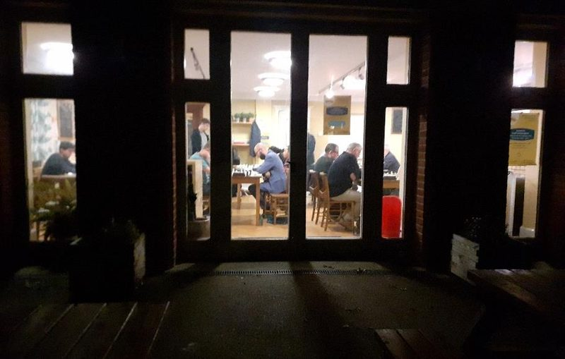

[Download the newsletter as a PDF](https://drive.google.com/file/d/1IyHDPF9rxGMa1CDXzGCn04NMJPTKUYPG/view?usp=sharing) (it has the photos and diagrams that are not on this page).

*Streatham and Brixton Chess Club Magazine – Number 27, December 2023. Follow us on Twitter [@Streathamchess](https://twitter.com/Streathamchess) – Website [streathamchess.org](https://streathamchess.org/)*



Welcome to this Christmas issue of the Club magazine, in which we announce two seasonal club/library group events and update you on the temporary arrangements while Streatham Library is closed to community groups. The seasonal break is also a good moment to look at the club’s progress in the leagues, take the long view into the New Year as we call out for your help running and growing the club. And finally, just like Santa’s sack, there are some tasty items hidden at the bottom. Have a great time over the holiday period – and try and solve the Xmas tree puzzle. White to mate in three.

### Club and Library Group Christmas Blitz (5 mins + 3spm) evening. Tuesday 19 December. 7.30pm sharp at St. Thomas’s Café, Telford Avenue.

ECF rated. Free entry, but voluntary donations to cover venue costs will be much appreciated. All Club Members and Library Group players welcome. Email Richard Tillett to register (contact details are in the PDF newsletter). See you there!

### Club and Library Group New Year Rapid, two evenings Tuesdays 2 and 16 January 2024. 7.30pm sharp at St Thomas’ Café, Telford Avenue.

<figure style="margin: 15px 0; clear: both;">

<figcaption><i>Chess at St. Thomas’s Café: fox-eye view.</i></figcaption>
</figure>

Six rounds @ 25 minutes all moves. ECF rated. Entry free, but voluntary donations welcome. Club Members and Library Group players invited. Email Richard Tillett to register (contact details are in the PDF newsletter). See you there!

### 4NCL Online – starts again 23 January – are you interested?

We are already recruiting to our 4NCL Online squads for our next campaign starting 23 January. Fortnightly on Tuesday evenings; 7.30 kick-off on Lichess; 45 minutes + 15spm. ECF membership required. We played two four-board teams last season, in Divisions 1 and 3 (and did pretty well, too!). Let Matt Tillett know if interested (contact details are in the PDF newsletter).

### We’ve found a temporary venue for our library chess group – Richard Tillett reports.

We were taken by surprise when we learned that the community hall at Streatham Library would be unavailable for several months, rather than the three weeks we were expecting. We didn’t want to shut down for such a long period, so we decided to look for a temporary venue. Thanks to one of our group members, the resourceful James Khan, we have found an excellent and inexpensive venue that will tide us over until we can return to the Library (probably early April 2024).

We’ll be playing in the function room of the Tooting Conservative Club, 12 Ashvale Road, London SW17 8PW ([their website is here](https://tootingconclub.site123.me/)) – meeting 16:30 to 19:30 every Tuesday except 26 December (Boxing Day), from Tuesday 12 December. The venue is close to Tooting Broadway underground station, [map here](https://www.google.co.uk/maps/place/Tooting+Conservative+&+Unionist+Club+Ltd/@51.4273109,-0.1676962,17z/data=!3m1!4b1!4m6!3m5!1s0x4876060b23afbc49:0xb557860dccfa9d26!8m2!3d51.4273109!4d-0.1659273!16s/g/1vljftcd?entry=ttu), and is on several useful bus routes including the 57 and the 333 if you are coming from Streatham. Our usual rule applies for children: under 10s to be accompanied by an adult. There’s a bar in an adjoining room serving tea and coffee, alcoholic drinks and snacks such as rolls. We need to raise £300 to cover the hire cost so we will be asking for voluntary donations.

### Social chess makes a comeback.

You could say that the success of the Library Group is part of today’s wider explosion of chess: the Queen’s Gambit effect; real time play on your screen; streaming and live commentary; accessible online learning and coaching tools – they all show that the Royal Game is alive and kicking. And not only at the level of ‘serious’ league and competition chess: there’s a new phenomenon (or the revival of an old tradition) relaxed social chess, maybe with a drink, coffee, sandwich, or pizza in hand.

The London Chess Community (aka ‘London Chess Club’) is outside the conventional chess mainstream. Social media is the lubricant, using [Meetup](https://www.meetup.com/london-chess-club/), [Facebook](https://www.facebook.com/groups/358942156036166?locale=en_GB), Twitter/X, etc, to announce what’s happening (always check before travelling!). South of the river venues include:

* the ‘London Chess Club’ at the Mercato Metropolitano Café at the Elephant (Sundays 10.00-4.00).
* the ‘Tooting Chess Club’ at the Graveney and Meadow pub, 40 Mitcham Road (Thursdays 7.00-10.00).
* the 8x8 club at Tooting Market (occasional Mondays 6.00pm).

We know that some Library Group/S&BCCers are already habitués of the Metropolitano at the Elephant – why not join them for a Sunday afternoon of social chess.

### Whither S&BCC? – Richard Tillett writes:

Change is afoot at Streatham & Brixton Chess Club. Both Martin Smith and James Toon have given notice that they have to step back from club management when the current season ends in the summer of 2024.

Martin and James have given fantastic service to our club and will be irreplaceable. But replace them we must, and in the New Year I’ll be working up a plan for how we can best fill the gaps that they will leave.

I see this as an opportunity for us to take a long, hard look at our club and what we need to do to take it forward. We are in good shape. We have a thriving membership base with players at all levels. Our finances are sound and are very capably superintended by Paul Ritchie, but we know that there is room, lots of it, for improvement. We also know that we won’t make much headway until we can recruit volunteers to strengthen our management group.

Maybe you can help. Do you have ideas about how our club should develop? Would you be interested in contributing your energy and expertise to help us improve? Do you have specialised skills in areas such as safeguarding, data protection, web development or social media? Might you be able to take on a team captaincy role? If you can answer ‘yes’ to any of these questions I would be delighted to hear from you!

My hope is that when we hold our next Annual General Meeting in summer 2024 we will have a road map in place and a new intake of officers and captains to take our club to the next level.

### League Results 2023-24 season:

It has been a slow start to the season, with disruption due to rail strikes, venue mishaps, etc. 2024 will consequently be rather congested. Thanks as ever to our team captains and managers for dealing with whatever fate throws at them.

Results are at 14 December 2023 (unless stated otherwise). NB ECF LMS scores 2 for a match win, and 1 for a match draw. For each team the figures are: match points / matches played; wins (+), draws (=) and losses (-); league position / number of teams.

#### London League ([league website](https://ecflms.org.uk/lms/node/82610/home))

* **Division 1; Streatham 1** (8 boards)
  * Match points / played: 4/4 (+2, =0, -2); position 4th/11
  * Special mentions: James Toon 2.5/3. See his game in the match v Richmond below.
  * Captain’s brief comment: We beat Athenaeum 8-0 by default, and also beat Battersea. But we lost to a strong Richmond team and had a collective off-night v Lewisham. We should still finish the season respectably mid-table.
* **Division 2; Streatham 2** (8 boards)
  * Match points / played: no play yet; position 11th/11
* **Eastman Cup; Streatham EC** (knock out, 3 rounds max, 8 boards, 4 teams)
  * Match points / played: 1/1 (+1, =0, -0); in semi-final
  * Special mentions: See Andrew Stone’s game v Hammersmith below.
  * Captain’s brief comment: We weren’t at full strength for the ¼ final v Mushrooms, so all credit to the players for grinding out a narrow victory.

#### Central London League ([league website](https://www.oxfordfusion.com/oca/index.cfm?Org=7))

* **Division 2; Streatham A** (5 boards)
  * Match points / played: 5/4 (+2, =1, -1); position 3rd/7
  * Captain’s brief comment: After an indifferent start our season is coming together. We showed what we can do with a convincing victory over Pimlico 3, followed by a close win over Div 2 leaders OTB Gnomes.
* **Division 4; Streatham B** (4 boards)
  * Match points / played: 5/4 (+1, =3, -0); position 2nd/6
  * Special mentions: We’ve fielded 9 players in 4 matches so far. Special mention to Elliott Hills and David Marshall settling straight into the team in their first season for the club.
  * Captain’s brief comment: We’ve made a promising start after finishing last in 22/23. Undefeated after 4 matches we sit 2nd in the table – and look forward to the second half of the season in 2024.

#### Croydon and District League ([league website](https://ecflms.org.uk/lms/node/80420/home)) – all CDCL 4 boards

* **Division A/Croydon Shield (Open); Streatham A**
  * Match points / played: 1/3 (+0, =1, -2); position 3rd/4
  * Captain’s brief comment: 3 tough away matches to start the season – aiming for better in 2nd half.
* **Division B/Martin Cath Trophy (7800); Streatham B**
  * Match points / played: 2/2 (+1, =0, -1); position 3rd/6
  * Special mentions: New player Ben Simpson’s super win is linked below.
  * Captain’s brief comment: Early days, but a 3 v 1 away win over South Norwood was encouraging.
* **Division C/Dave Luckin Trophy (6600); Streatham C**
  * Match points / played: 0/0; position -/8
  * Captain’s brief comment: Season not started
* **Division D/Deric Cox (5800); Streatham D**
  * Match points / played: 2/2 (+0, =2, -0); position 3rd/6
  * Captain’s brief comment: A fair start to the season – two draws from two matches.

#### Surrey League ([league website](https://www.scca.co.uk/comps/comps_index.html))

* **Alexander Cup; Streatham** (knock out over 3 rounds, 10 boards, 7 teams)
  * Match points / played: 0/1 (+0, =0, -1)
  * Captain’s brief comment: Lost in first round to Kingston 3 v 7.

#### Online 4NCL ([league website](https://www.4ncl.co.uk/))

* **Division 1 Group B; Streatham A** (4 boards)
  * Match points / played: 9/7 (+3, =3, -1); position 3rd/8
  * Captain’s brief comment: Missed out on a semi-final place by one game point 15 v 16: bad luck!
* **Division 3 Group A; Streatham B** (4 boards)
  * Match points / played: 5/7 (+2, =1, -4); position 6th/8
  * Captain’s brief comment: Promoted last season from Division 4. Fought well this season in a tough Division.

#### County Matches.

Another mention for the popular Surrey matches against other home counties. Teams at all levels; relaxed time control; friendly atmosphere, venues in and around London (lifts sometimes available) – what’s not to like! S&BCC ir/regulars include: Tony Cullen, Martin Dale, James Fox, Robin Haldane, Elliott Hills, John Hodgson, Alan Romeril, Martin Smith, Richard Tillett, all of whom have played for Surrey teams during the current season. See [here](https://ecflms.org.uk/lms/node/63543/home) for more information and match results.

### Some S&BCC games.

This is a small selection of eye-catching games played recently by S&BCCers.

First a smash and grab job by 10-year-old Charlie Pearson, in our second team in Division 3 of the Online 4NCL. See it [here in Chapter 1 of this Lichess Study](https://lichess.org/study/7AaLVjYD/hVJKKJSL). Nice one Charlie – more wins like that please!



Next up John Hodgson, who had FM Bob Eames on the backfoot in an earlier round of the OL4NCL. Team manager Matt Tillett comments: ‘John played well to get a winning advantage, but the FM showed good skill in complicating the ending and managing a draw in the end.’ See it in [Chapter 2 of the same Lichess Study](https://lichess.org/study/7AaLVjYD/ZrcGjq1r). Bad luck John – so close!



**Ben Simpson** – already playing London League for Dulwich – has joined us to play in the Croydon and Surrey Leagues. He has made his mark with some impressive wins, including this magnificent game from our CDCL B match v South Norwood: [https://lichess.org/study/KzGdwtJv#sEwnPsVl](https://lichess.org/study/KzGdwtJv/sEwnPsVl). Check out that stunning rook lift 17…Ra6!



Thanks to **James Toon** for sending over commentaries on a couple of his league games. Below is a hard-fought win from a London League Division 1 match against Richmond: very instructive to follow the thought-process of a strong player.

#### A. Stewart – J. Toon 0-1

*London League, 2023.11.07*

A36: English, ultra-symmetrical variation

Streatham 1 v Richmond 1, London League Division 1. Richmond put out a very strong team for this match and outrated us by an average of 150 points a board. My board 5 opponent, Ashley Stewart, is rated 2198, so only about 100 rating points higher than me.

**1.c4 c5**

I have tried several responses to the English Opening. The Symmetrical Variation is the latest and most successful of these. I found IM David Vigorito’s Chessable course very helpful.

**2.g3 Nc6 3.Bg2 g6 4.Nc3 Bg7 5.a3**

The main move, and objectively best, is 5.Nf3, although the Botvinnik Variation with d3, e4 and Nge2 has always been popular. Endorsed by GM Simon Williams in his book The Iron English. Instead, White’s move 5.a3 looks to take action by preparing b4, sacrificing a pawn if necessary for the initiative. This works well if Black weakens the dark squares with …e6.

**5...d6**

This move (recommended by Vigorito and others) effectively counters White’s plan. Black continues with normal developing moves. Effectively White is a tempo down on the main lines.

**6.Nf3 e5 7.O-O Nge7**

So now we have a Reverse Botvinnik Variation.

**8.Ne1**

The main anti-Botvinnik plan for White involves rerouting the knight from f3 via c2 and e3 to d5, stopping Black playing …d5 and establishing a piece blockade in front of the backward pawn. But it’s slow and Black can proceed anyway – especially when White has lost a tempo with a3. It would have been better for White to stick with the queenside plan and play Rb1 preparing b4.

**8...Be6 9.d3 O-O 10.Nd5**

This is the wrong knight for the d5 square. As Vigorito points out, White wants the other knight on d5, keeping this one on c3 to hold back Black’s …b5 pawn break. But 10.Nd5 is the only way to stop Black advancing the d-pawn.

**10...Rb8 11.Bg5 Nf6 12.Bd2 b5 13.Rb1**

I was expecting 13.cxb5 which results in a better pawn structure for White than the game continuation. Also, after 13.cxb5 Rxb5, White can follow up with b4 simplifying the position on the queenside.

**13...bxc4 14.dxc4 Bf5**

White can’t move the rook. I wanted to provoke e4, after which the d4 square is mine forever and a monster knight will land there soon.

**15.Nxe7+ Nxe7 16.Nc2 Qd7 17.Bc3**

I think this has two aims. First, it opens a line against the backward pawn on d6. Second, it defends the b2 pawn, so that if I attack the knight with …Qa4, White can defend it with Rc1 rather than having to play e4.

**17...Rfd8 18.Qd2 Be6**

Black has more than one plan. I was interested in manoeuvring the knight to d4 via c6 or f5, but it doesn’t achieve anything as long as White has e3 in reserve to kick the knight away. And in fact, the freeing move …d5 is the right plan as it’s now well supported by my pieces.

**19.b3 d5 20.cxd5 Nxd5 21.Qe1**

White thought for a long time before playing this. He wants to get a rook to the d-file. It’s rather passive but I can’t think of a better plan for him and in fact I was expecting this move.

**21...Nxc3 22.Qxc3 Qd2!**

White may have missed or under-estimated this move – maybe he thought I had to defend the c5 pawn. 23.Qxd2 Rxd2 is miserable for White, so he’s more or less forced to go all in.

**23.Qxc5**

This is the critical point in the game. White’s pawn grab is a risky strategy since the queen and knight are obvious targets for a skewer on the c-file. He probably thought he could defend against that. Alternatively Black can simply take on e2 with the queen or on b3 with the rook (though not the bishop, which fails tactically). These were my fallback options if I couldn’t find anything stronger.

**23...Bf8**

I spent a long time thinking about 23…Rbc8 which forces 24.Bc6. Then I can attack the bishop with …Rd6 or …Qd6. I was concerned about 24…Rd6 25.Nb4 which seems to hold, and 24…Qd6 25.Qxd6 Rxd6 26.Be4 f5 27.Bd3 e4 28.Bc4. In some lines I come out with two bishops for a rook and pawn and objectively I should be better, but it would be hard to win. So instead, I played 23…Bf8, forcing the queen to move to a less favourable square. This is good, but even better would have been combining the two ideas with 23…Rbc8 24.Bc6 Bf8 when the queen has to vacate the c-file and I can pick up the knight on c2 on more advantageous terms. My opponent pointed this out to me after the game.

**24.Qc6**

Attacking the bishop on e6, so I can’t put a rook on c8 immediately.

**24...Rb6**

I spent some time thinking about which rook to place on the 6th rank. 24…Rd6 25.Qc7 loses to 25…Rc8, so he’s forced to go in for complications with 25.Rbd1. Then 25… Qxd1 26.Rxd1 Rxd1+ 27.Bf1 Bh3 28.Ne3 looked as it if it might hold. I didn’t take it any further but later realised that 28…Rc8 29.Qb5 (there are no checks) Rxf1+! 30.Nxf1 Rc1 31.e3 Rxf1+ 32.Qxf1 Bxf1 33.Kxf1 Bxa3 leaves Black a piece up in a completely winning ending. As I couldn’t see through to the end, I went instead for 24…Rb6 when 25.Rbd1 doesn’t work because of 25…Qxd1 26.Rxd1 Rxd1+ and now 27.Bf1 loses the queen to 27…Rxc6.

**25.Qf3**

Giving up the knight in order to win a second pawn and generate some activity. But objectively it can’t be enough – Black’s king is well defended, and the White pawns are ripe for harvesting. In fact, I had not considered this move. Instead I analysed 25.Qc7 when 25…Rc8 skewering the queen and knight (my initial plan) doesn’t work because after 26.Qxa7 the rook on b6 is hanging, so instead 25…Rd7 26.Qc8 Rf7 when the queen has leave the c-file and I can take the knight.

**25...Qxc2 26.Qxf6**

Attacking both the rook on d8 and a third pawn on e5. This may have been as far as my opponent analysed.

**26...Rd2**

Now 27.Qxe5 Rxe2 and the White queenside pawns will drop off.

**27.Rbc1 Qf5**

This keeps the e5 pawn and forces the White queen offside. After this I just need to be careful in order to bring home the win.

**28.Qh4 Rd4 29.f4**

29.e4 Qf7 is worse for White because it restricts the scope of the bishop on g2.

**29...exf4 30.Rc7**

With a certain threat (as GM Simon Williams is fond of saying).

**30...Bg7**

There are several ways to defend. I decided to put the bishop on g7 because it gives me the option of a bishop check on d4 in some lines.

**31.Qe7 Qf8 32.Qg5 Rxb3 33.Rxa7 Rxa3**

The White queenside has disappeared, and I am now a straight piece up.

**34.Rb7 Rda4**

Vacating the d4 square for the bishop and introducing the idea of …Ra1 to exchange a pair of rooks.

**35.Qb5 Ra5 36.Qb1**

Other queen moves allow 36…Qc5+ exchanging queens. But this is no good either.

**36...Ra1 37.Qd3 Rxf1+ 38.Bxf1 Qc5+**

King moves lose the rook to 39…Bd5+ so he is forced to allow the queen trade.

**39.e3 Qxe3+ 40.Qxe3 fxe3 41.Re7 Bf7 42.Be2**

Obviously, he can’t take on e3.

**42...Bd5 43.Bf1 Ra1 44.Re8+ Kf7 45.Rd8 e2**

I was pleased with the way the game went as it showed that inaccurate play in the opening has adverse consequences in the middlegame and endgame if one responds correctly.

**0-1**

*Finally, **Andrew Stone’s** impressive win in a combative line against the King’s Indian. Thanks to Andrew for the comprehensive notes in a game which shows why he is the Player of the Year 2022-23!*

Andrew writes: Played on board 2 in the close Eastman Cup match against Mushrooms, where this game was the last to finish and all the previous games had been drawn. I had beaten my opponent with black in about 20 moves in the early summer so maybe he was looking for revenge.

Notes were written without seeing what Stockfish thought. I have indicated where I have added Stockfish’s suggestions but have mainly kept the notes computer free.

**White: Stone, Andrew: Black: Iyengar, I.**

**1. c4 Nf6 2. Nf3 g6 3. Nc3 Bg7 4. e4 d6 5. d4 O-O 6. Be2**

My first main line Classical King’s Indian for 20 years or so. Although I have been pretty happy with my Fianchetto King’s Indian, 6 Be2 adds some variety to my repertoire,

**e5 7. O-O Nc6 8. d5 Ne7 9. b4 Nh5** {apparently the main line} **10.Re1 a5**

Playing the other major system as well for good measure!

**11. Ba3** After a couple of minutes thought, I assumed that the reply to a5 on move 9. was the way to proceed, as here.

**axb4 12. Bxb4 b6 13. a4**

I had played a4 quickly, assuming that taking advantage of the semi outpost with 13. Nb5 was not better (pressuring c7 and hard to be kicked away – stuff that computers seem to like these days). It feels that taking the knight away from overlooking the e4 square is not natural at this stage.

**13... Nf4 14. Bf1** The standard reaction explaining why Re1 was played (to clear the square for the bishop). This was a big thing “back in the day” and, helped by Kramnik’s efforts, made this line very popular.

**14…f5**

having read a good book, but very light on experience and theory, there were several themes/features occurring to me during the opening. One here was that after f7-f5, a major option is to play Nf3-g5 and then cause trouble on e6. It looks like the e6 pawn (after say Ne6 (Bxe6) d5xe6) is doomed. However, it is not so easy for black to capture, and white can cause trouble with Nd5. Here however black has a knight on f4, which presumably rules out most Nf3-g5-e6 jumps.

**15. a5**

I thought this was the natural way to break down black’s queenside, but there may be an issue... (15. g3 {this might be desirable(?) but tactically fxe4 seems an issue} fxe4 16. Nxe4 Nh3+ {assumed this was not great for me despite the knight being rather short of escape squares (will the knight ever want to escape?)}).

**15... fxe4 16. Nd2**

18-minute think here. There were several candidate moves, but they all seemed to have issues: (i) (16. Ng5 Nexd5 17. Nxd5 Qxg5 18. Nxf4 {missed this move} (18. Nxc7 Nh3+ 19. Kh1 Nxf2+) 18... exf4 {but the queen covers d5 anyway which stops white winning material with Qd5+}) (ii) 16. Nxe4 Bg4 {was concerned about this. Stockfish isn’t!}, then (a)17. Re3 Nf5; or b) 17. Qb3 Bxf3 (17... Nh3+) 18. Qxf3 Nfxd5; or (c) 17. Ra3 bxa5 18. Bxa5 Bxf3 19. Qxf3 Nfxd5; or (d)17. axb6 {Stockfish} Nh3+ 18. Kh1 Rxa1 19. bxc7 Qxc7 20. Qxa1.

**16... Nd3**

He also thought for 14 mins here. (16... c5 {this looked problematic} 17. dxc6 Nxc6 18. Ba3 Nxa5 (18... bxa5 19. Ndxe4) (18... Qg5 19. Ndxe4 Nh3+ 20. Kh1 Nxf2+ 21. Nxf2 Rxf2 22. Ne4) 19. Ndxe4 {I saw this though and wondered if this would be good anyway – the d6 pawn looks to be going}) (16... h6 {illustrating a variation} 17. axb6 Rxa1 18. bxc7 Rxd1 19. cxd8=Q Rxe1 (19... Rxd8 20. Rxd1) 20. Qxe7).

**17. Bxd3 exd3 18. axb6 Rxa1**

Surprised he thought 6 mins and he now had 37 mins to my 45.

**19. Qxa1**

19. bxc7 Rxd1 20. cxd8=Q Rxe1+ {after Bf1xd3 this dxc7 zwichenzug is now a huge blunder as Rxe1 is now check!}

**19... cxb6**

Another 5 mins here – I sensed he was a time trouble addict around here. However, he may have been dissatisfied with his position and was trying to find an alternative (19... c5 20. Ba5 {whilst Ba5/b4 could soon become pretty static, assumed the free b6 pawn was well worth having, as he could hardly ignore it})

**20. Nce4**

20. Nde4 {this allows more firepower attacking d6 as it frees up Nc3-b5. Was concerned about weak c4 pawn though, and the possibly annoying d3-d2}

**20... Nf5 21. Qb1**

One of three queen moves that looks to directly round up the d3 pawn. I wasn’t sure if they would all amount to the same thing. This move was chosen to keep an eye on e1.

**21…Rf7**

Putting up the barricades. Spent 17 of his last 31 minutes – clearly going to get in big time trouble} (21... Nd4 22. Bxd6 (22. Qxd3) 22... Ne2+ 23. Rxe2 dxe2 24. Bxf8)

**22. Qxd3 Bf8** {freeing up the knight} **23. Ra1 h6**

Spending 9 of your last 12 minutes on this move starts to begin to look like a serious time trouble addiction or a deliberate attempt to throw the opponent off balance.

**24. Ra8**

Looks good but soon gets pushed back and not sure I can provide back up (in the form of Qa3 yet). To be honest, taking 1 min over this (with 34 mins now left) may indicate that being affected by his time trouble.

**24...Qc7 25. Nc3 Bd7 26. Nde4**

This shuffle changes my decision from move 20 when I was concerned about my c4 pawn and his possible d3-d2. The d3 pawn is gone, the c4 pawn is perhaps slightly better protected.

**26…Kg7 27. h3**

Bit of a cop out providing protection against back rank threats. 27. g4 {spent some time on this.} Nh4 28. Rxf8 {would be a good thing to hit him with a minute on his clock. Afterwards, however, he said he was hoping for “this sort of thing” and it looked rather messy, albeit quite possibly in my favour. Stockfish said I had a small edge but isn’t worth going into} Rxf8 29. Bxd6 Rf3 {I hadn’t seen this but there again had already recognised that something unexpected may well be around and it wasn’t worth getting involved with g2-g4}.

**27... Be7 28. Nd2 Qb7**

Around here I realised (from watching the clock when he moved) that the increment was 15 seconds rather than the 10 I had assumed! Still not exactly to continually move at this pace (although may build up a small bank of time if you get 2-3 “easy” moves to make).

**29. Ra2 Nd4 30. Nde4 Qc7 31. Ne2 Nxe2+ 32. Qxe2 Rf4**

This didn’t accomplish anything and allowed me to change from attacking d6 to b6.

**33. Bd2 Rf8 34. Be3 Rb8 35. Rb2 Bf5 36. Nc3 Rc8**

With many of the preceding moves, if something didn’t work out, I could just have another go doing something else; However, this attack on c4 would have clarified the position – and, if I exchanged c4 for b6, lessen his problems. Fortunately I had seen in advance that I could just defend c4 with my rook (and that it would not be hassled there either).

**37. Rb4 Rb8 38. Qd2 g5 39. Qb2 Bd3 40. Nb5 Qc8**

I felt at the time this was the decisive error (40... Qd7 41. Nd4 {Stockfish points out that any queen move was problematic for him however by tactically using the d4 square to access c6 or e6}).

**41. Na7 Qa6 42. Nc6 Re8 43. Qc3 Bf5 44. Nxe7 Rxe7 45. Rxb6 Qc8 46. Rxd6 Bxh3** {I felt this was coming} **47. Bxg5**

Unlike him, I had about 15 mins left so could calculate in relative leisure. I felt I could probably take the bishop, but that this was simpler.

**47…hxg5 48. Qxh3 Qxc4**

(48...Qxh3 49. gxh3 Rc7 50. Rc6 {my extra connected passed pawns will not be stopped})

**49. Qh6+** {I calculated this when played Bxg5} **Kf7** (49... Kg8 50. Qg6+ Kf8 51. Rd8+ Re8 52. Rxe8#)

**50. Qh7+ Kf8** (50... Ke8 51. Qg8#) **51. Qh8+ Kf7 52. Rf6#** 1-0

Thought he defended well and suspect he has turned the tables in his own time trouble many times before. However, it was just too much to cope with a variety of threats whilst playing on increment for about 25 moves.

*Thanks Andrew – interesting insights on a fine win!*
