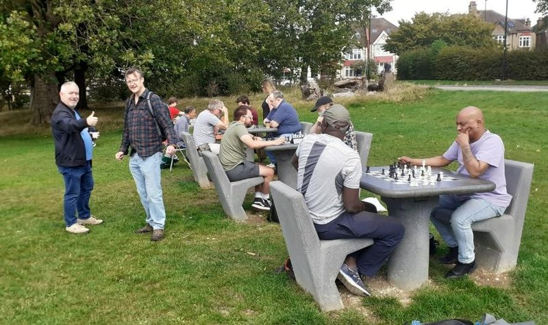

[Download the newsletter as a PDF](/assets/newsletter/club-newsletter-no-28-march-2024.pdf) (it has the photos and diagrams that are not on this page).

*Streatham and Brixton Chess Club Magazine, Number 28, March 2024 – follow us on Twitter [@Streathamchess](https://twitter.com/Streathamchess) – website [streathamchess.org](https://streathamchess.org/)*

### Welcome to this Spring issue of the Club magazine…

…in which we review the ongoing 2023/24 league season (including developments at the Library Group), look forward to the summer, and continue our planning for 2024/25. We also catch up on the exploits of one or two of our members away from the leagues…

### … but first: results of our internal club/library group events since the last issue of the Magazine.

#### Christmas Blitz (7 rounds), 19 December, at St. Thomas’s Café.



Well done Graham Keane (left) who was first on 7 points - unbeaten over all seven rounds, which included two wins against second-placed Robin Haldane (on 5 points), and wins over third-placed Ruairi Isaacs and fourth placed Kostya Titorenko (both on 4). Special mention to Ruairi, who continues to improve against tough opposition, and welcome back Kostya, who we haven’t seen for some time. 10 competed – great to see you all. Thanks to Alan Romeril who stepped in as Tournament Controller. Final table (no longer online).

#### New Year Rapid (6 rounds), 2 and 16 January, at St. Thomas’s Café.



Well done Ben Simpson (more about Ben below), finishing with 5 points, losing only to Mark O’Neill (right), who was second on 4.5. Special ‘well done’ to third-placed Ibrahim Abouchakra, the top-placed Library player, on 4. Thanks to Tournament Controller James Toon for foregoing, yet again, the chance to play. Altogether an encouraging 15 players took part (some for one evening only) including up-coming Charlie Pearson (just 11-years old – more about him below as well). Final table (no longer online).

**Thanks to everyone** who chipped in to cover our room-hire costs at these events. Every little helps!

### …and a reminder about subs. from our Treasurer Paul Ritchie.

Yes, time to pay up please if you haven’t already. The rates are the same as last season – what a bargain! £45.00 or £22.50 concessions/new members. Please make your payment by transfer to our Santander account (the account details are in the PDF newsletter). You can also use PayPal [here](https://www.paypal.com/paypalme/SBchessclub) or pay cash to a club captain or officer.

### Library Group Developments.

**Richard Tillett writes…**

We’ve been in temporary accommodation at the Tooting Conservative Club in Tooting Broadway since December of last year, while the community hall at Streatham Library has been out of action. This has proved to be a very satisfactory base for us with ample seating and decent tables, and there’s even a snooker room and bar - I’ll miss my pint of Guinness when we get back to the Library!

Excellent though it is, it’s not Streatham Library. There’s something special about libraries – they are inclusive, public spaces where everyone can feel comfortable. So it’s no surprise that attendance numbers have fallen off. Around 15-25 people have been attending our sessions, which is around half the number that were coming to the Library.

Unfortunately the refurbishment work at the Library has been delayed and it’s looking unlikely that we’ll be able to return before mid-May. For updates visit the [Chess at Streatham Library](https://sites.google.com/site/chessatstreathamlibrary/chess-at-streatham-library) website.

### Whither S&BCC - Part 2.

**Richard Tillett writes…**

As we reported in the last issue of the newsletter, Martin Smith and James Toon will both be stepping back from club management in the summer. They will leave two very big gaps, but this does give us the opportunity to review the way we run the club and bring in new people with fresh ideas.

I’ve been encouraged by the willingness of people to help out, and I’m confident we can assemble a team of volunteers to take us forward.

I want to have a clear plan in place by the next Annual General Meeting, which we will probably hold in July or August. In the next few week I will be having conversations with everyone who has already offered to help out (and some who haven’t – you have been warned!).

### Round up of League Results at 28 March 2024.

#### Highlights:

* The First team in the London League is holding its own in Division 1, but was knocked out in semi-final of Eastman Cup. It is still early days for our Second team in Division 2.
* Our A and B teams are near top of their tables in Divisions 2 and 4 of the Central London League.
* All our four teams are doing well in the Croydon League.
* Our 4NCL Online teams are surging ahead in Divisions 1 and 3.
* Plenty to celebrate!

Each entry gives the league, division and S&BCC team designation, plus a link to the league website or EMS page. NB ECF LMS scores 2 for a match win, and 1 for a match draw. For each team the figures are: match points/played; matches won, drawn and lost (+ = -); current league position/number of teams; and the captain’s comments or special mentions.

**London League** – [https://lms.englishchess.org.uk/lms/organisation/1267](https://lms.englishchess.org.uk/lms/organisation/1267)

* **Division 1; Streatham 1.** 8 boards. Captain: James Toon.
  * Match points/played: 10/7; won 5, drawn –, lost 2; current position 3rd/11.
  * After an excellent win against 2nd-placed Hammersmith, the LL 1st team is currently 3rd in the table with three matches still to play. We are likely to finish 3rd or 4th depending on results. That would be a very good outcome for us as the Division seems to be getting stronger year by year. We have used 18 players so far – significantly fewer than last season. Most active players: Andrew Stone and Graham Keane – 6 each. Best performance: James Toon with 3.5/4.
* **Division 2; Streatham 2.** 8 boards. Captain: Antony Hall.
  * Match points/played: 4/4; won 2, drawn –, lost 2; current position 9th/11.
  * After a number of postponements for reasons beyond our control, we finally got underway in January with a narrow win over BBCA. Despite our rating advantage it was a nervy evening, but it kept them in the relegation zone. Next, down with a bump v Kings Head 1, who had won all their matches up to that point. Both teams were missing top players, and the average ratings were close, but a gritty performance. We then lost to Imperial College where we were unlucky to come away empty-handed, but bounced back in style with a win over Cavendish 2 - our first against them for ten years.
* **Eastman Cup. Streatham EC** (Knock out. 3 rounds max. 8 boards, 4 teams). Captain: James Toon.
  * Match points/played: 1/2; won 1, drawn –, lost 1; lost in semi-final.
  * Narrowly lost to Richmond in the semi-final – they went on to defeat Hammersmith in the final.

**Central London League** – [https://www.oxfordfusion.com/oca/index.cfm?Org=7](https://www.oxfordfusion.com/oca/index.cfm?Org=7)

* **Division 2. Double round. Streatham A** (5 boards). Captain: James Toon.
  * Match points/played: 14/9; won 6, drawn 2, lost 1; current position 2nd/7.
  * The A team is currently 2nd/7 in a two horse race with OTB Gnomes. We play them 11 April to likely determine who wins the Division and promotion. This competition has proved very popular – the venue is convenient for many of our players. All matches are over-subscribed, creating the right kind of selection headache. Andrew Stone 7 games and John Carlin 6, John Hodgson 3.5/5.
* **Division 4. Double round. Streatham B** (4 boards). Captain: Paul Ritchie.
  * Match points/played: 9/7; won 3, drawn 3, lost 1; current position 2nd/6.
  * The main aim with this team is to provide opportunities to play for as many team members as possible – not just field the strongest team on paper. With three matches remaining, including a double header against basement dwellers Hackney 2, there is a possibility of a top of the table decider against Wanstead 2 in May!

**Croydon and District League** – [https://lms.englishchess.org.uk/lms/organisation/1250](https://lms.englishchess.org.uk/lms/organisation/1250) (All CDCL 4 boards). Captain all teams: Richard Tillett.

* **Division A/Croydon Shield (Open). Double round. Streatham A**
  * Match points/played: 3/4; won 1, drawn 1, lost 2; current position 2nd/4.
  * As tough as ever with all four clubs putting out strong teams, averaging nearly 2100 per player. We’re doing OK now after losing our first two matches.
* **Division B/Martin Cath Trophy (7800). Streatham B**
  * Match points/played: 4/4; won 2, drawn –, lost 2; current position 3rd/6.
  * Our first season in this division since pre-Covid. We’re in decent shape with a 50% score and one match left to play.
* **Division C/Dave Luckin Trophy (6600). Streatham C**
  * Match points/played: 6/4; won 3, drawn –, lost 1; current position 1st/8.
  * This is the largest of the Croydon League divisions with eight teams. We’re in pole position, one point ahead of the chasing pack with three matches still to play.
* **Division D/Deric Cox (5800). Streatham D**
  * Match points/played: 6/5; won 2, drawn 2, lost 1; current position 1st/6.
  * Currently topping the table but likely to be overtaken as we’ve completed our fixtures and others still have matches to play. 13 players in total including several first-timers.

**Surrey League** – [https://www.scca.co.uk/comps/comps_index.html](https://www.scca.co.uk/comps/comps_index.html)

* **Alexander Cup. Streatham** (Knock out over 3 rounds, 10 Boards, 7 teams). Captain: Martin Smith.
  * Match points/played: 0/1; won –, drawn –, lost 1.
  * Lost in first round to Kingston 3 v 7.

**Online 4NCL; Season 9** – [https://www.4ncl.co.uk/](https://www.4ncl.co.uk/). Captain both teams: Matt Tillett.

* **Division 1 Group B; Streatham A** (4 Boards)
  * Match points/played: 8/5; won 5, drawn –, lost –; current position 1st/8.
  * Played five won 5 – it doesn‘t get better than that. We are two points clear at the top of Division 1 Group B with two rounds to go till the play-offs against the Group A winners. Fingers crossed!
* **Division 3 Group A; Streatham B** (4 Boards)
  * Match points/played: 7/5; won 3, drawn 1, lost 1; current position 2nd/8.
  * This is our second season in Division 3 and we’re doing well in Group A, just one point behind the leaders.

### Members round up – where we report on some noteworthy chess exploits of our members. Please keep them coming!

#### Qixiang and Qixuan Han

Congratulations to Qixiang Han on winning the on London Junior Chess U10 Championship (Major) held last December. He scored 6.5/7 without losing a game. Both he and brother Qixuan have been playing for our London League teams, and Qixiang has played in the Central London League. They show great promise, and we look forward to them playing lots for us in the Leagues. Historical note: running since 1924, the London Junior Championship started out as the London Boys Championship. Indeed, that is how it was styled when your editor played in it 60 years ago, and Robin Haldane 50 (albeit in older age groups than Qixiang).

#### Charlie Pearson

Eleven year-old Charlie is in his first season with the club. He only started playing chess in 2023 and already he is cutting his teeth in our Croydon League teams. With his dad’s (Nicholas) permission we reprint this email reporting Charlie’s stunning success in a recent Junior tournament at Coulsdon:

*“I took Charlie to a chess tournament in Coulsdon on Saturday. 26 players, 7 rounds, 25 mins on clock. He started seeded 12th in terms of ratings. He won the whole thing, would you believe! Six wins and one loss. He was particularly thrilled by his win in Game 3, against the top seed. As you know, I don’t really understand what I’m talking about, but apparently he was down a piece, then found a way -- via a double knight sacrifice -- to run his opponent’s king from c1 to a8, which forced a resignation a move before Charlie would checkmate. I think everything after that was just gravy for Charlie – he was shaking with emotion and told me he thought he had played the best game of his life. It seemed to me that he glimpsed something beautiful in chess in that game that really affected him. Anyway, it was a load of fun, and the result qualifies him for the next round of the English Chess Challenge in May.”*

Great stuff, Charlie! Lovely to see that the chess bug has well and truly bitten. Good luck in May!

#### Ben Simpson





By contrast Ben Simpson *(left)* has had a long playing career, and is now a regular in our top CDCL and CLL teams (he remains loyal to Dulwich in the London League). Ben played in the Cambridge International Open (*pictured left*) over nine rounds 19th -24th February. It was won by elite GM Michael Adams in a field containing an array of GMs and IMs. Ben was drawn against two of the latter and several other 2000+ players, emerging at the end of a tough week with 4/9 points. Perhaps his finest moment was this spectacular 7th round win, which you can play through [here](https://lichess.org/study/Xb13Fi7N) (*see Chapter 1*). *In the diagram above*, Ben played the dramatic 33…Qf1 – which was enough to bamboozle his opponent, who replied with reasonable-looking 34. Rd1 (34. Qd1!), losing to the killer 34…Ne2.



#### James Toon

When he is not helping run the club, organising, and playing in our LL and CLL first teams, controlling our internal tournaments (for this season, anyway), and helping out at Guildford CC and the London League Committee, James is playing Correspondence Chess. Not the one move a year with your at Christmas card variety, but high volume stuff with multiple games on the go at once. In the two years in which he has been playing in competitions of the International Correspondence Chess Federation James has played 377 games, achieving the title of Correspondence Chess Master. Congratulations James! Next stop the IM title. See a recent OTB game of James’s below: complete with his instructive notes.

### Coming up soon:

#### SCCU team Rapidplay: Saturday 22 June, St Luke’s Church NW3 7SU.

We had 4-board teams in all three Sections last year (average 2100, 1850, and 1600). Website [here](https://sccu-chess.com/index.php/en/london-club-champs). Drop Richard Tillett an email if you would like to play (contact details are in the PDF newsletter). You have to be an ECF member, Bronze or above.

#### Summer blitz and rapid play competitions at St Thomas’ Café.

We’re planning to hold two rated OTB events during the summer, as we did last year: a blitz night and a six-round rapidplay over two nights. Possibly also an online club competition.

#### Guildford Chess Congress: Friday 12 to Sunday 14 April, Guildford University GU2 7XH.

[5-round Swiss tournament](https://www.guildfordchessclub.com/): Open, Major (U2000), Minor (U1600). All sections are both ECF-rated and FIDE-rated. The total prize fund is £2,600. Entry fee £45; Closing date 11 April. 160 places – filling up fast.

#### Surrey CCA Individual Summer Tournaments (standard play).

Four tournaments organised according to player strength (in all-play-all sections of four to six) - played at four venues (Surbiton on Weds, Wimbledon on Mons, South Norwood and Dorking both Thursdays) according to demand; three or four games a month, starting at 7.30pm. Closing date 19th April; start date 29th April. ECF Bronze required. Click [here](https://www.scca.co.uk/SCCA/docs/Surrey_Individuals_2024_Entry_Form_Rules_Combined_REV_08.docx) to download the entry form.

#### Playing online correspondence chess for Surrey.

Every year Surrey enters teams in the Counties & District Correspondence Chess Championship. This is a national competition for 8-board teams with three divisions and is played on the International Correspondence Chess Federation web platform. Each team member plays two games against the same opponent, one with the black pieces and the other with white. What makes this competition unusual is that computer assistance is permitted. The 2024 competition will be starting in April and the Surrey teams are currently being assembled. If you are interested email Richard Tillett (contact details are in the PDF newsletter), but you’ll have to be quick as the deadline for entries is fast approaching and there are only a handful of places left.

#### Heritage Day at Woodfield Pavilion, Saturday 1 June, Woodfield Pavilion, Tooting Common (organised by the Streatham Society).

It’s a chance to advertise the heritage of the club (we are 153 years old, after all), and the library group, by some informal social chess with the general public. Let Martin Smith know if you’d like to help out.

#### Chess on Streatham Common.

With the weather picking up, it’s time to think about chess on the common again. Dates to be announced.

<figure style="margin: 15px 0; clear: both;">

</figure>

### James’s Game

See below. You can also play through the moves in a Lichess study [here](https://lichess.org/study/Xb13Fi7N) (*see Chapter 2*).

**J.Toon - C.Bates 1-0** London League, 2024.02.27 E11: Bogo-Indian Defence, Grünfeld variation. Streatham 1 v Richmond 1, London League Eastman cup semi-final. Board 4. Caspar Bates is rated 2123.

1.d4 e6 2.c4 Nf6 3.Nf3 I respect the Nimzo-Indian too much to allow anyone to play it against me. So… 3...Bb4+ 4.Nbd2 …obviously not 4.Nc3 here. 4.Bd2 is the most popular move. 4.Nbd2 keeps more play in the position. 4...Qe7 This is normal after 4.Bd2, but unusual here. Black generally castles or plays …b6 to develop the light-squared bishop. However, 4…Qe7 is thematic in that Black wants to play a dark-square strategy by exchanging the dark-squared bishop and putting his central pawns on dark squares, so this prepares …e5. 5.a3 Bxd2+ 6.Bxd2 There's something to be said for the other captures: Nxd2 would prepare e4 taking control of the centre, and Qxd2 intends fianchettoing the bishop on b2. In each case a different kind of game would result. 6...d6 7.Bg5 O-O 8.e3 e5 9.dxe5 I played this to keep things simple but arguably it's better to retain the central tension and develop instead. 9...dxe5 10.Be2 Nc6 11.Qc2 h6 12.Bxf6 12.h4 was tempting since Black can't take the bishop, but simply 12…e4 and I have to exchange on f6 anyway. 12...Qxf6 13.O-O Bf5 An obvious move, developing with tempo, but it pushes my queen to c3 where it wants to go. Now the pawn on e5 comes under pressure and Black won't be able to move it without allowing Qxf6 which ends his attack and damages his pawn structure. 14.Qc3 Rfe8 15.b4 b6 Black wanted to meet b5 with …Na5. He can't attack on the kingside here: 15...Qg6 16.b5 Bh3 Better is 16...Nb8 17.Nh4 Qe6 18.Nxf5 Qxf5 19.c5 but this still leaves me with a queenside initiative. 17.Nh4 Qg5 18.bxc6 Qxh4 19.cxb7 Rab8 20.gxh3 Black has lost a piece. 16.Rfd1 Be4 16...e4 17.Qxf6 gxf6 18.Nd4 Nxd4 19.exd4 leaves me with the better pawn structure in the ending. 17.Nd2 Bg6 18.Bf3 I played this to force the exchange that follows, but maybe stronger is opening lines for the bishop with 18.c5. 18...e4 19.Qxf6 gxf6 20.Be2 a5 I was expecting 20...Ne5 when 21.Nb3 prepares c5 or else Nd4. It would be premature for Black to occupy d3: 21...Nd3 22.Bxd3 exd3 23.Rac1 Rad8 24.Rc3 and the pawn on d3 will eventually drop off. Instead Black tries to open lines on the queenside himself. 21.bxa5 I was concerned about creating a hole on c5 and fixing the pawns on the same square as my bishop, but on reflection it would have stronger to play 21.b5 since after 21...Ne5 22.Nb1 Nd3 23.Nc3 my knight reaches the strong square d5 and Black has to defend the backward pawn on c7. 21...Nxa5 22.c5 A positional pawn sacrifice which gives me a passed a-pawn. 22...bxc5 23.Nc4 Bh5 23...Nxc4 24.Bxc4 when I have the better bishop and pawn structure. Black's extra pawn counts for nothing. So instead he decides to exchange off his worst piece. 24.Bxh5 24.Nxa5? would be a serious mistake, because 24...Bxe2 25.Re1 Bd3 26.Nb3 c4 27.Nd4 is very strong for Black. Knowing which pieces to exchange is an important aspect of positional play.

24...Nxc4 In contrast, my bishop is much stronger than the black knight in this ending. It's a long-range piece and is more effective when there are pawns on both sides of the board. 25.Rd7 This double attack regains the pawn as Black must defend against the threat to f7. 25...Ne5 26.Rxc7 Rec8 27.Rxc8+ Rxc8 The next stage of the plan is to re-route the bishop to c2 where it supports the a4 pawn advance, blocks the passed pawn on c5, and threatens the pawn on e4. 28.Bd1 f5 29.Bc2 c4 30.Kf1 Kf8 31.Rb1 There's a case for pushing the a-pawn but I wanted to activate the rook and invade Black's crumbling kingside. It's surprising how quickly Black's position goes downhill after this. 31...Ke7 32.Rb5 Kd6 33.Ke2 Taking time to improve my king position. Black is a bit tied down since the knight can't move without dropping the f5 pawn and the king has to defend the knight. 33...Ra8 34.a4 f6 35.f4 This wins a pawn, but I don't have to rush and on reflection I could first have improved my king position further with Kd2-c3. 35...exf3+ 36.gxf3 f4 37.Rb6+ Black can choose which of the f-pawns he gives up. 37...Kc5 38.Rxf6 fxe3 39.Kxe3 Re8 40.Kd2 Rg8 Black understandably wants to get active, but it would have been better to improve the knight's position with …Nc6-d4. 41.Rf5 Kd4 42.Rf4+ Kc5 43.Kc3 The point of my rook manoeuvre is to ensure that the rook protects the h-pawn when I advance it to h4. 43...Rg5 44.h4 Rg3 45.Be4 Rg1 46.Rf5 Kd6 47.Rf6+ Ke7 47...Kc5 48.Re6 wins a piece, since if the knight moves then Rc6 is mate. 48.Rxh6 This leaves me two pawns up with a clearly winning position. I didn't consider Black's next move, which changes and simplifies the position but doesn't affect the outcome. 48...Nxf3 49.Bxf3 Rg3 50.Kxc4 Rxf3 Resulting in the ending of rook and two pawns v rook. This is almost always winning. Having two rook pawns makes it more difficult because Black has drawing chances if he can get his king to one of the corners blocking one of the pawns, while the rook alternately watches the other pawn and checks the White king. In this particular position, however, all White's pieces are well placed and the ending is straightforward. Later analysis showed that this 6-piece ending is a database win with optimal play. The plan is to advance the king and a-pawn to a point where Black runs out of checks, then advance the h-pawn. At some point White will be able to release the rook from the h-file with terminal threats. 51.Kb5 Rb3+ 52.Ka6 Kd7 53.a5 Kc7 54.h5 Rh3 55.Rh7+ Kb8 56.h6 Rh1 57.Rh8+ Kc7 58.h7 Rh6+ 59.Ka7 Rh5 Threatening mate, so… 60.a6 Kd7 61.Rb8 Threatening to queen the h-pawn. 61…Rxh7 loses to the skewer 62.Rb7+, so Black resigned. 1-0


