[Download the newsletter as a PDF](/assets/newsletter/club-newsletter-no-29-august-2024.pdf) (it has the photos and diagrams that are not on this page).

*Streatham and Brixton Chess Club Magazine, Number 29, August 2024 – follow us on Twitter [@Streathamchess](https://twitter.com/Streathamchess) – website [streathamchess.org](https://streathamchess.org/)*

### Welcome to the Summer issue of the Club magazine…

…in which we look back over the 2023/24 league season and catch up with other chess activities by our members. But first we look forward to new initiatives and changes coming up in S&BCC.

### All change

As we reported in our last issue, James Toon (who has been doing brilliant work for us in the London, and Central London, Leagues – not to mention running our internal club tournaments) is withdrawing from his club and team management roles. Martin Smith (currently Club President) is also pulling back. Richard Tillett, our over-burdened lynch-pin Club Secretary, explains where we might go from here.

#### Whither S&B? Richard Tillett reckons the time for change has come...

“To improve is to change; to be perfect is to change often.” So said Winston Churchill, who may not have been much of a chess player, but did know a thing or two about what it takes to win. Browse through Martin Smith’s [history of S&B (PDF, 47 MB download)](https://github.com/streathamchess/streathamchess.github.io/releases/download/club-history/history-of-sb-martin-smith.pdf) and you will see how often our club has changed through its 153-year existence. It is because we adapted, either by necessity or design, that we are still around today.

Now the time has come for our club to change once again. Why? By necessity - because two of our most experienced and dedicated committee members, Martin Smith and James Toon, are stepping back from their management roles. This leaves two big gaps which must be filled if we are to function effectively and build on our reputation as a substantial and well-run chess club. Necessity, as they say, is the mother of invention, and this is surely a golden opportunity to take a long hard look at ourselves, address some significant shortcomings, and involve more of our members in club management. In short, we need to create a positive vision for our future.

In recent months I’ve been talking to club members, looking at how other successful chess clubs manage their affairs, and thinking hard about the actions we can take to bring us up to speed. There’s lots that needs doing: improving and modernising our communications; providing members with more playing opportunities; better and more rigorous compliance procedures (safeguarding, GDPR, complaints procedures etc); rethinking our management structure. I’m now putting my thoughts into shape in the form of a road map for the future of the club, which I’m hoping we can consider and adopt at our club’s next Annual General Meeting at the end of August.

Recent AGMs have been modest occasions, mostly rubber-stamping decisions already taken by the committee, electing club officers, and signing off the financial statements. This year I’m hoping we will have a bigger turnout of members so that we can think about the future direction of the club. I will be putting myself up for re-election as club Secretary again. It will be my 24th year in the role. If elected I will have a busy year coordinating and executing the actions we need to take. Then, at the 2025 AGM, it will be my turn to step back from club administration, by which time I’m hoping we will be able to look at an ambitious transformation, successfully implemented.

***Streatham & Brixton Chess Club’s 2024 AGM will be held at Streatham Library on Saturday 31 August at 10.00am, more info to follow.***

#### A warning from Richard Tillett: Watch out, there are WhatsApps about!

We are planning a major revamp of our club communications. Gulp. That’s a lot of work, but some things we can do quite easily, like setting up WhatsApp groups. The more demanding tasks, like renewing the club website and replacing this quarterly pdf magazine with more frequent email newsletters, will take time.

So we’ll start with the easy bit – the WhatsApp groups. These will reduce our reliance on emails and allow us to send out quick and simple messaging. Two new WhatsApp groups are planned. One is for S&B members and would be for newsy items such as match results. Also it would be great when someone drops out from a match at the last minute and we need a sub. Members could use it for comment and suggestions, and for practical purposes like disposing of old chess books and magazines. The second WhatsApp group is for the Library players, and this is needed for updates and general information. For example, sometimes the community hall at Streatham Library becomes unavailable at short notice when we need to be able to get a quick alert out.

### How we did in 2023/24

#### James Toon reports on excellent performances in London League Division 1, and Eastman Cup.

In the London League Division 1, we held our own to finish on 6/11 in an increasingly strong competition, winning 5 and losing 5 of our 10 matches. Our best result was a 5–3 victory over Hammersmith 1, who went on to finish second behind Wood Green. The victory was never in doubt even though we made it harder by defaulting on bottom board. Andrew Stone and Graham Keane were the most active, playing 9 games each.

<figure style="margin: 15px 0; clear: both;">
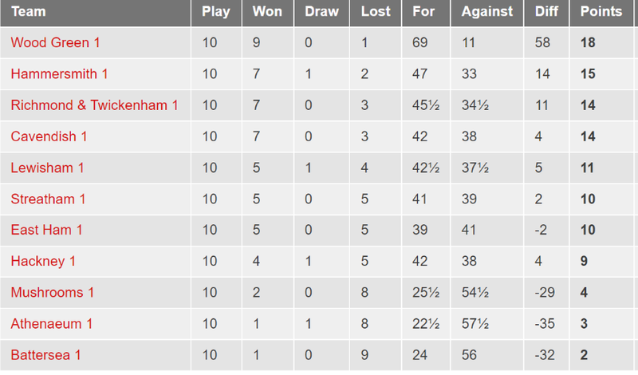
<figcaption><i>London League Division 1 final table, 2023/24</i></figcaption>
</figure>

In the Eastman Cup knockout tournament, we beat Mushrooms in the first round before going out to Richmond in the semi-final. Both matches were very close, finishing 4.5–3.5.

#### Antony Hall reports on a nail-biting season in London League Division 2.

In the 2023-24 season, the LL 2nd team finished 8th (out of 11 teams) in Division 2, with 4 wins and 6 defeats, scoring 39 GP (41 against).

<figure style="margin: 15px 0; clear: both;">
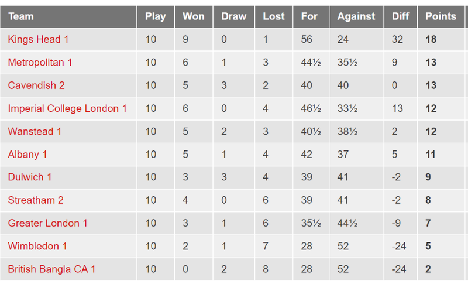
<figcaption><i>London League Division 2 final table, 2023/24</i></figcaption>
</figure>

Frustratingly, our opening two matches scheduled for October were both postponed, so we didn’t get going until January when we beat British Bangla Chess Association. We didn't capitalise on this as we failed to win consecutive matches and went down to several close defeats (half our matches finished 4½ -3½).

We hovered around the 50% mark for much of the season before getting dragged into a relegation dogfight. With four matches remaining, we needed just a draw from any of them to stay up, as BBCA were relegated and the other spot would go either to us or Wimbledon. We didn’t make it easy for ourselves, however, as we suffered three close defeats. As it happened, our final match was against Wimbledon, and it was a winner takes all encounter. We prevailed in a close match to ensure another season in the second tier, where we have lived happily since 2013.

As one of only two 2nd teams in the division, we also had the challenge of balancing eligibility considerations with our LL 1st team. The highlight of the season was beating Cavendish 2 for the first time in ten years! Most games played: Robin Haldane, Jagdip Patel, and myself (10/10). Top score: Jagdip (5/10). Best percentage: Matthew Tillett (64% - of those playing at least five matches). 19 players represented the team. 7 played just one game. Results for all London League competitions are [here](https://lms.englishchess.org.uk/lms/node/82610/home).

#### James Toon again on an exciting season in the Central London League Division 2.

The Central London League Division 2 was exciting all season. Two teams were clearly better than the rest: our A team and the new outfit OTB Gnomes.

<figure style="margin: 15px 0; clear: both;">
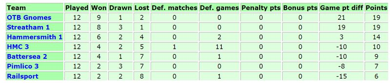
<figcaption><i>Central London League Division 2 final table, 2023/24</i></figcaption>
</figure>

We had the better of the direct encounters, winning one 3–2 and drawing the other 2.5–2.5. Both teams finished on 9.5/12, but the Gnomes had a slightly better board point difference so they clinched promotion to D1 next year and we must do it all again. This was the first season for our 1st team squad in the CLL but it proved very popular and our teams were always over-subscribed. Andrew Stone played 10 games and John Carlin 9.

Looking at our overall performance across all the three competitions above that I captained: we called on 23 players in total with an average rating of about 2050. The most successful player was myself, with 83% from 9 games (6 wins, 3 draws and 0 losses) against opponents rated 2020.

Best of luck to our new captains next season – Graham Keane in the London League D1, and Andrew Stone in the Central London League D2.

#### Paul Ritchie reports on a successful season for our B team in the Central London League Division 4.

For the CLL 2nd team in Division 4, there was no promotion, trophy, cash prize, book token, nor acknowledgment of any kind from the league authorities, but we were league victors, nonetheless.

<figure style="margin: 15px 0; clear: both;">
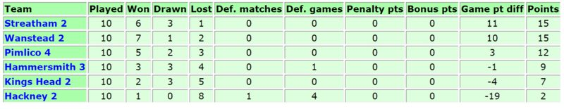
<figcaption><i>Central London League Division 4 final table, 2023/24</i></figcaption>
</figure>



After a slow start to the season, we won our last 5 matches in a row. Special mentions to new players Elliot Hills and David Marshall (whose thrilling victory in the last match against Wanstead won us the league) and to James Fox, who was imperious on top board with a result of 5 out of 6.

#### Mixed fortunes for our 4-board teams in the Croydon League – Richard Tillett summarises.

To get the bad news out of the way first, we finished bottom of Division 1, the Croydon Shield, with one win, one draw and four losses. The previous season we also propped up the table when we had the same problem - struggling to get our strongest team out. Our opponents outrated us in every match except one, our home fixture against Petts Wood & Orpington, which was our solitary victory. We’ll have another shot at the title next season when, fingers crossed, we’ll be able to put out stronger teams. Special thanks to stalwarts Robin Haldane and Ben Simpson, both of whom played in five of the six matches.

Better news in Division 2, the Martin Cath Trophy, where we had enough players to enter a team for the first time since pre Covid. I thought we might struggle, but as things turned out we were one of the stronger teams in the division and performed well, scoring three wins, two losses and no draws. We ended the season in second place one point behind the winners, Coulsdon. Once again Robin Haldane and Ben Simpson were key players for us, scoring 3.5/4 and 3/4 respectively.

<figure style="margin: 15px 0; clear: both;">
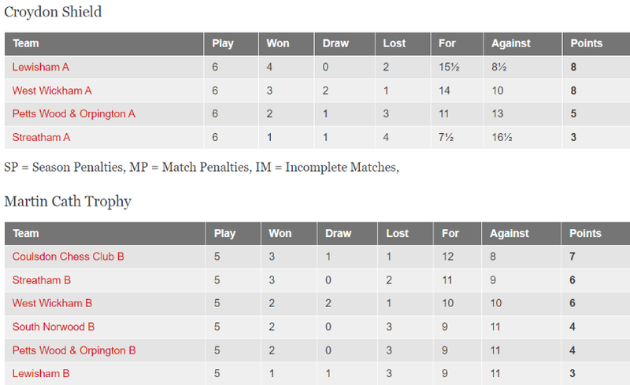
<figcaption><i>Croydon Shield (Division 1) and Martin Cath Trophy (Division 2) final tables</i></figcaption>
</figure>

Our teams in Division 3, the Dave Luckin Trophy, and Division 4, the Deric Cox Trophy, are about giving new club members and improvers opportunities to play rather than coming top of their tables. Nonetheless we achieved creditable finishes in both divisions – third in the Dave Luckin and second in the Deric Cox. Most matches were oversubscribed. No fewer than 20 of our members played for the two teams, some of whom were gaining their first experience of rated competitive chess.

<figure style="margin: 15px 0; clear: both;">
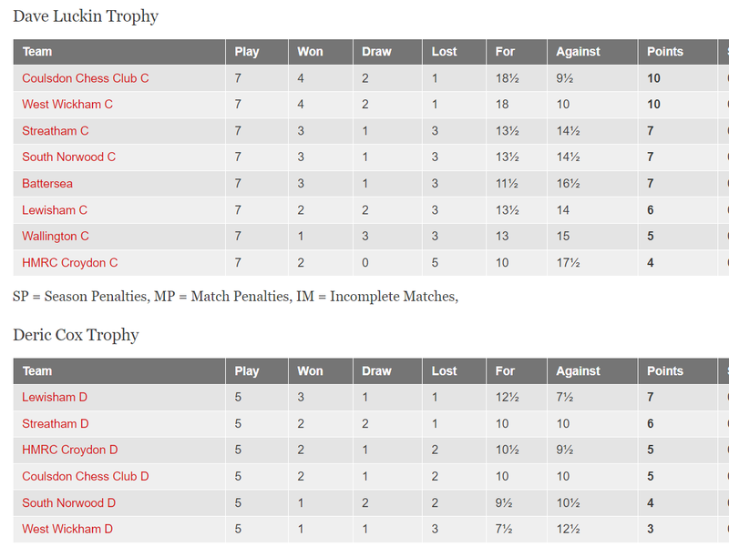
<figcaption><i>Dave Luckin Trophy (Division 3) and Deric Cox Trophy (Division 4) final tables</i></figcaption>
</figure>

Next season we are planning to enter a team in each of the four divisions again, and possibly also a team in the Rapidplay Division if there are enough team entries for it to be competitive (there weren’t last year). A big thank-you to Martin Smith for lifts to the away venues in Divisions 1 and 2, some of which are quite distant (that’s an understatement!). Tables for all the Croydon League divisions are [here](https://lms.englishchess.org.uk/lms/node/80420/tables) – use the ‘Fixtures’ tab to navigate to the match score cards.

#### Matt Tillett reports on great performances in the OnLine 4NCL, Season 9.

Once again, we entered two teams into the 4NCL Online competition, a format which involves fielding four board teams against opposition from all around the country, on a 45 minute time control.

The A team, playing in the top division, did very well, winning all seven matches and finishing top of their section (Group B). We went down 2.5 - 1.5 in a tough semi-final match, but it was still a great effort by all. A special mention to Venkat and Andrew Stone who played in every match, only losing one match each.

<figure style="margin: 15px 0; clear: both;">
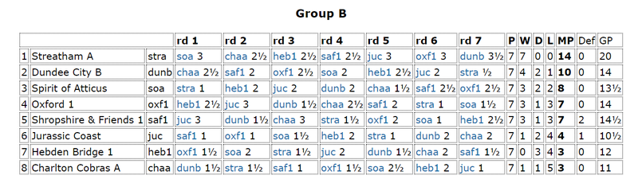
<figcaption><i>Division 1, Group B</i></figcaption>
</figure>

The B team held their own in Group A of Division 3, often against higher rated opposition, finishing mid table.

<figure style="margin: 15px 0; clear: both;">
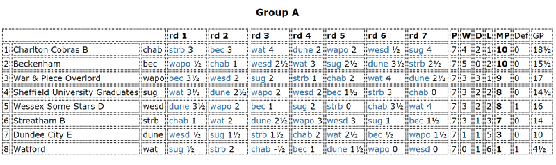
<figcaption><i>Division 3, Group A</i></figcaption>
</figure>

Great to see some new recruits playing, Charlie Pearson, Qixiang and Qixuan Han, all of whom posted some good wins for us.

All Season 9 OL4NCL results are [here](https://4ncl.co.uk/data/onlines9/online_results_9.htm). Season 10 begins in September. Look out for a player call sometime in August and please let me know if you are interested (contact details are in the PDF newsletter).

#### Martin Smith reports on our three team entry in the SCCU London Team Rapid 22 June

For the second year running we strongly supported this event (6 rounds at 25 mins + 5 spm) organised by the Southern Counties Chess Union. It attracted some 40 teams from across London. We entered two teams in the Major (u2100 average), and one in the intermediate (u1800).

It was a fun day of tough chess, with our 2nd team in the Major (John Carlin, Ben Simpson, Robin Haldane, Graham Keane.) finishing 2nd/5 with 14/24 game points. They pipped our 1st team (Venkat, Andrew Stone, John Hodgson., Andrew Ponting, Antony Hall) who, with 12.5 game points, came 3rd/5. Well done guys, especially Venkat who got the ‘Silver Pieces’ Award for the highest individual score (5.5/6). Ben and Robin both scored over 50%. Robin provided a memorable highlight in Round 5 by successfully defending a K+N v K+R ending, which went on long after all other games had finished. Robin’s masterclass demonstrated the secret of the rearguard action: keep the K and N together so the N doesn’t get isolated and can help shelter the K. Easy when you know how.

<figure style="margin: 15px 0; clear: both;">
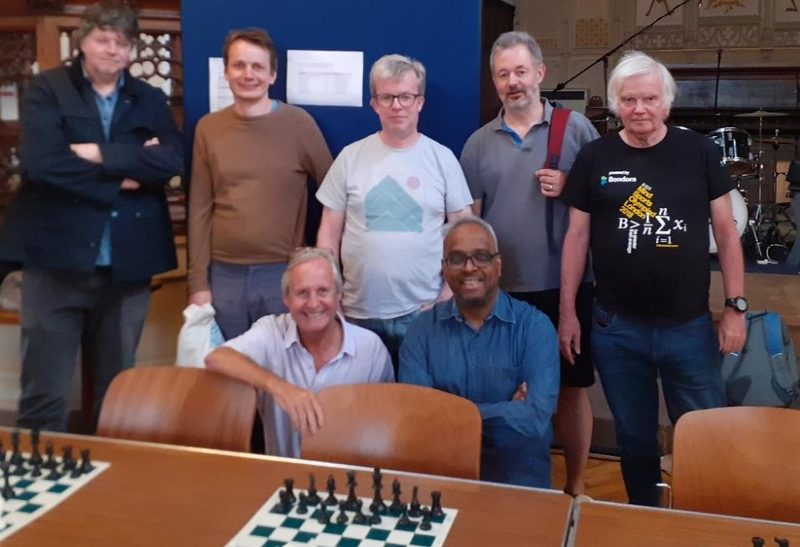
<figcaption><i>Some of S&BCC’s players, left to right, standing: Dave V., Ben S., John C., Antony H., Robin H; seated: Graham K, Venkat.</i></figcaption>
</figure>

The third team (Martin Smith, David Varley, James Fox, Ruairi Isaacs, Chris Barnard) in the Intermediate, was in a strong field of 14 teams. Though seeded 4th, it finished 10th. Standout players were Ruairi with 4.5/6, and Dave with 4/6. Special thanks to Chris who stepped in on board 4 when James dropped out after round 3. Chris, by the way, is Secretary of the SCCU, which hosted the event.

So, we had three teams (brilliantly organised by Richard Tillett juggling the line-ups to keep within the rating limits) with 14 Streatham players participating (15 if you count Ed Mospan, who was playing for Kingston in the u1600 Minor). It would be great to get a full Streatham team in the Minor next year.

#### Martin Smith on the Alexander Cup in the Surrey County Competitions

In the last two seasons we have entered Surrey’s ten board Knock-out: the Alexander Cup. We can never get past the big beasts of the county: Kingston for example, to whom we lost last time 3 v 7 in the first round. And ten boards is a big ask for us for any distant away match. Still it’s a good for the club’s *esprit de corps*, so maybe we should give it another go.

### Club internal tournaments – gone and upcoming

#### Rapidplay 2 and 9 July

<figure style="margin: 15px 0; clear: both;">
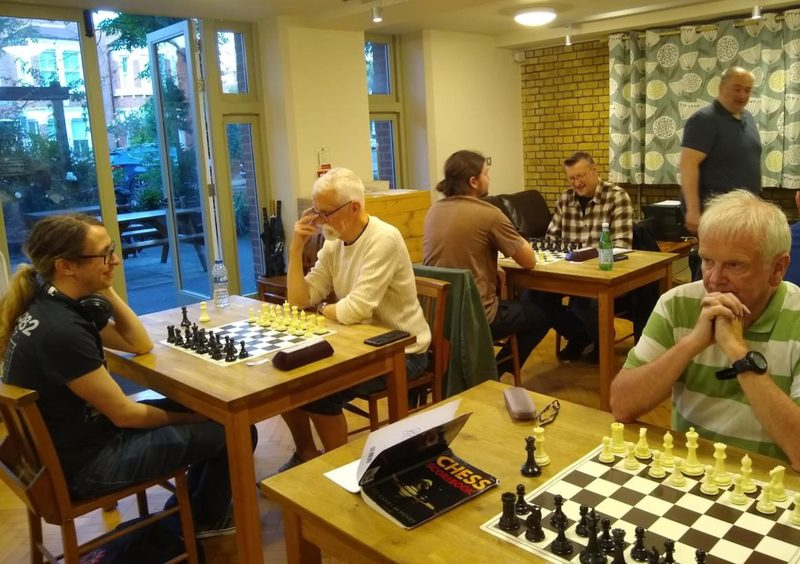
<figcaption><i>About to start Round 2, left to right: Will Moffat, Martin Smith, Elliott Hills, Ed Mospan, Alan Romeril (tournament controller, standing), Robin Haldane.</i></figcaption>
</figure>

In our end of season Rapid, was six rounds (at 25 minutes per game) over 2 evenings – attracting 15 participants from the club and Library (though many could play one evening only). Robin H., and Graham K., finished jointly ahead of the field with 5.5 each (they played a fighting draw against each other, shaking hands when Robin got counterplay despite dropping a piece). Welcome to Austin Sopocko, up from Southampton University, playing in his first S&BCC event. He finished 3rd with an excellent 3.5/6. We hope to see more of Austin, studies permitting. Alan Romeril did a splendid job running the Swiss Manager software for the first time, also successfully posting the round-by-round results left and [here](https://chess-results.com/tnr963611.aspx?lan=1&art=4).

<figure style="margin: 15px 0; clear: both;">
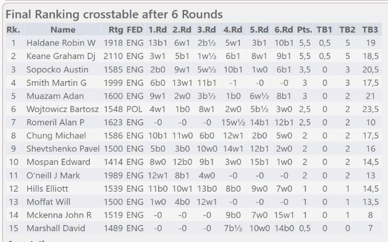
<figcaption><i>Final ranking crosstable after 6 rounds</i></figcaption>
</figure>

#### Online Summer Tournament

Thanks to James Toon for organising his swan song online tournament. With an entry of six it was an ‘all-play-all’ at 45mins per game. Good to see junior Charlie Pearson competing (see below) and taking a point off one of our more experienced players. Good also to see Jonathan Bryant (once a very active member) taking part. First team player John Hodgson emerged winner, dropping a half point only to Angus French (another member who made a great contribution to the club in the past). All results can be seen [here](https://chess-results.com/tnr955209.aspx?lan=1&art=4).

#### An internal club competition next season?

Several members have suggested we hold an annual standardplay club competition to provide more opportunities to play rated chess. Great idea, and in the next week or two Richard Tillett will be writing to club members to see how much interest there is. Entry will be free for club members but we may ask Library players to pay an entry fee to help cover our costs. Our intention is to make this a season-long competition which would run at the St Thomas’s Cafe with flexible play-by dates. The format is to be confirmed once we have a clear idea of likely player numbers and the rating range. If some of our stronger players want to participate, we could designate it as our club championship. We even have an ancient, if somewhat dilapidated, trophy gathering dust - the last winner was your Editor. In 2001!

### S&BCC Members out and about

#### Qixiang and Qixuan Han

We’ve been delighted to welcome brothers Qixiang and Qixuan Han to the club, both making a strong impression in the London League and online; and we hope that they will continue to play for us. They have been impressive in several tournaments recently, including a five round rapid at [Wimbledon](https://chess-results.com/tnr940171.aspx?lan=1&art=1&rd=5): Qixiang won the event with 4.5/5, drawing with IM Peter Large, and beating GM Alexander Cherniaev in the final round! (revenge perhaps for Cherniaev beating his brother in round 2), Qixuan himself finished a decent 5th with 3 points. Qixiang has also played for the County u2050 team, winning on board 6 against Middlesex.

#### Charlie Pearson

Charlie is another junior fearlessly taking on the older generation (see Summer Tournament above). Picking on players his own size he recently qualified for the English Junior Chess National Youth Finals in Nottingham.

Dad Nicholas takes up the story: *“we’ve just had a wonderful weekend - five games over two and half days, 90 mins + 30 sec increments. Charlie went into the tournament ranked 24th out of 41. He drew game 1 against the number 4 seed on the Friday night, so a good start. He also drew the Saturday morning game, which left him mid-table. Then, in the afternoon, he got into an almighty tussle that went over three hours, but he emerged victorious. He won again on Sunday morning. And then, would you believe it, in the afternoon too, to leave him finished outright third on 4 out of 5 points. It was an incredible weekend. There were coaches there, and lectures. He had one of his games analysed by Lorin D’Costa (National Youth Team Coach - MS), which was a highlight.”*

Charlie also competed in the Southern Gigafinal of the UK Chess Challenge (15m+10spm) for under-twelve juniors at Sandown Park in July. He cruised to 5/7 and bagged a place in the upcoming Challengers tournament in Northampton in September – that’s just one step away from the national Terafinal. Good luck Charlie!

#### Jagdip Patel

Well done Jagdip (one of our second tier regulars), who won a rating prize at the Pimlico Summer Tournament, Open Section. He was 21st on the starting rank with his ECF rating of 1921, finishing (five rounds later) with 3 points, in 12th position, for an impressive tournament performance rating of 2052. The Han brothers were also playing: Qixiang finished 11th (3 points), and Qixuan 16th (2.5 points). John McKenna scored 50% in the Major.

#### James Toon



Post-lockdown James (a member on and off over several decades) has made a massive contribution to the success of our LL1 and Eastman Cup teams, and has brilliantly controlled our internal tournaments. He will now be concentrating his exceptional organising skills elsewhere (sparing himself the arduous journeys from beyond Guildford up to Streatham) – though we may still see him playing in the LL.

To thank him for his work for the LL1 team we presented James with a copy of the book on GM Simen Agdestein “Games and Goals”- signed by the team. Football and chess are James’s twin passions – in the latter he has just achieved norms for the titles of Correspondence Chess IM and Senior Correspondence IM. Congratulations James, and thanks for everything.

### Odds and Ends

#### Chess in the Community



The club can trace its roots back just over 150 years – a venerable history that earned us an invite to set up our boards at Lambeth’s Heritage Day on 1st June, at the Woodfield Pavilion at the top of Tooting Common (*right*). Thanks to Alan Romeril for co-ordinating our input and for those many members who came along to show off our chess talents. It was a good to advertise the club and library group, and show that chess is a game for everyone.

#### Last newsletter

You are reading the last issue of the Magazine in its current format. We started it back in March 2020 in the depths of COVID lockdown when the club closed its doors, league chess was suspended, and online was the only way to play. We then thought that a Magazine-cum-Newsletter was a good way of keeping in touch with our members and showing the Club hadn’t gone away. That was then, and this is now, 29 issues later. Times they are a-changing in S&BCC, and it’s the moment to explore how we can make our club communications more effective for the future, perhaps using other media not widely used four or five years ago (see Richard’s piece about WhatsApp above). The Magazine has been fun to produce, and we hope enjoyable to read. For what comes next: watch your Inbox.

\[Photo credits in this issue, in order: Paul Ritchie, MS, Richard Tillett, Jing Han, Nicholas Pearson, MS, Alan Romeril.\]
