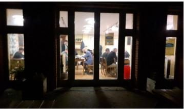
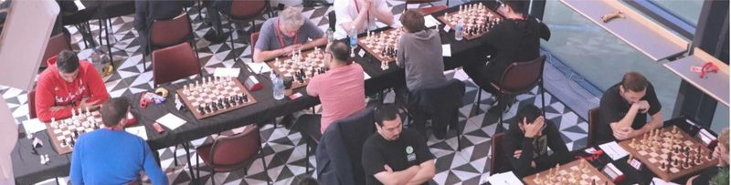
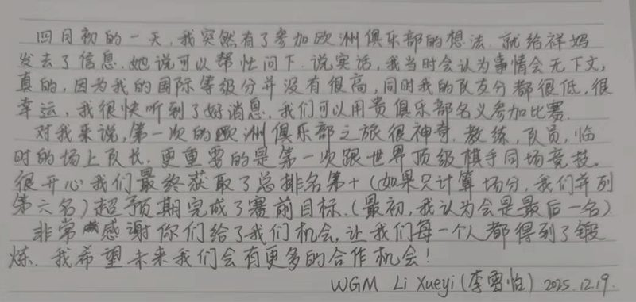

[Download the newsletter as a PDF](https://drive.google.com/file/d/1NKwoh7EsVAfEAt1ahP518COyQhDGW2PJ/view?usp=sharing) (it has the photos and diagrams that are not on this page).

*Club management – Library Group – club nights/events – league reports – tournament action – plus other news*

Happy New Year! We are now into the New Year, and after a slow start the 2025/26 League seasons are now underway. On top of that, club nights are happening, the Library Group is flourishing, and a new management committee is in charge. Read on!

### Club Management – Antony Hall and Chris Bernard report

Chris Bernard took over as Club Secretary at the September AGM, Antony Hall continued as President and Paul Ritchie as Treasurer. Chris has initiated using AI to summarise management meeting minutes. The Principal Officers (Chris, Antony, Paul) had their first meeting in September, followed soon after by another including team captains (both over Zoom).



Graham Keane agreed to become the club’s safeguarding officer. He has a wealth of experience in safeguarding having worked as a teacher for many years, has recently completed an updated safeguarding course and has renewed his Enhanced DBS checks. Graham should be the first point of contact for any safeguarding issues. Chris, however, will act as safeguarding lead ensuring the club conforms to the ECF's Safeguarding Policies and Procedures and will produce an annual safeguarding audit. He is confident we now conform to the ECF Safeguarding Policies & procedures and that officials and team captains are aware of their responsibilities. A parental consent form will be circulated for final review, and the club’s insurance policy with the ECF will be renewed: just one of many things for early 2026!

### Library Group – Richard Tillett reports

2025 was the best-ever year for our Chess at Streatham Library Group. We attracted a steady stream of regulars, returners, and new faces. Together we create a welcoming and supportive group – a haven where we can absorb ourselves in chess and escape the stresses and challenges of the everyday. Great work as always by James Khan and Ed Mospan. Ed is planning to resume the popular rated rapids (introduced last year) from 27 January – message him to play.

Our group goes from strength to strength, but a consultation exercise last Summer resulted in a very clear shortcoming... We want more women to join our group! So, roll up ladies, roll up!

### Club Nights – Richard Tillett reports

<figure style="margin: 15px 0; clear: both;">

<figcaption><i>Club Night or Night Club?</i></figcaption>
</figure>

A club institution over 20 years ago, Club Nights made a trial return (at St. Thomas’s Café) in the autumn starting with mostly well-supported blitz evenings and a couple of informal social nights. Our original intention was to introduce entry fees gradually; however, Ed and I decided to charge a small fee for blitz and other rated chess nights (£5 club members, £3 non-members) from the outset. This was well received, and although entry fees and donations are not covering all our rental costs, we think it is working model for regular sessions and we should be able to put something on most, if not every, week - with seasonal breaks.

The Club Nights programme embraces the club’s seasonal internal tournaments and scheduled league matches: see what is coming up on the [Club Calendar](/calendar/) – and via the dedicated WhatsApp feed (message Richard or Ed to join). We hope to overcome the obstacles to reinstating this venerable club tradition as it continues into the new year as a work in progress.

**Next Club Night/Club Tournament Events** – St. Thomas’s Café, 7.30 kick-off

* Tuesday 20 January: January Blitz
* Tuesday 27 January: Open Night (to be confirmed)
* Tuesday 3 February: Winter Rapidplay rounds 1-3
* Tuesday 10 February: Winter Rapidplay rounds 4-6

### Reports from the Leagues

#### London League Division 1 – Martin Smith filling in for Graham Keane

Our LL1 team under captain Graham Keane won the first two of its three pre-Christmas matches: a thumping 7 v 1 win against Mushrooms followed by another emphatic 6 v 2 win against UCL, putting us briefly top of the League. Then Wood Green paid us the compliment of fielding five GMs, and a team averaging 2429 ECF (against our 2221) to be sure of their victory: 7.5 v 0.5 (Venkat drew on board 1). So, that aside, a decent start to our LLI season, where coming second in the Division to ever-dominant, GM-loaded, Wood Green would be as good as winning it.

#### Division 2 – Antony Hall reports

We played two matches before Christmas and your captain was not involved in either. Our first was against promotion favourites King's College London. I had so many higher rated players available that I stood aside to play for our Central London League 2nd team at Pimlico (their captain, Andrew Ponting, played for my LL2 side!). Unfortunately, we suffered an alarming 7-1 defeat. Stand-in captain Martin Smith reported that “I think it flattered them a touch. The ratings were not really against us, and we missed a few tricks that would have shown a fairer outcome.” Martin and new member Yaseen Mamanji both drew.

Then against Hammersmith 2 (whose player pool is much stronger than ours) we managed a creditable draw, despite two late withdrawals due to illness. I was abroad so Graham Keane kindly captained. We are bottom of Div 2 but most of the teams have lost matches so I am not too concerned... yet!

#### Intermediate – Ed Mospan

We are 6 matches into the season, and in 2nd place having won 3, drawn 1 and lost 2. Our last match at Battersea v their Goats team was marred by their rating violations (2 players above the 1650 limit) resulting in the unusual score line (after penalties) of -2 v 4!

#### Central London League. Division 1 – Andrew Stone reports

Though newly promoted to the top Division, SB1 is one of four title contenders. Most teams have now played 6/14 matches, and the four are indeed in the top spots. We are third (+5, =3, -1) but are 5 points off the leaders OTB1 (+5, =2, -0), with no chance of narrowing the gap by beating them - the only points they have dropped are from their two draws against us. We have also played the other two contenders: drawing with Rangers and losing 0.5 v 4.5 to HMC. Any hope of winning the league now depends on beating the bottom four teams, just as we dispatched Pimlico Knights by an aggregate score of 9-1. We may not come top but should make a decent first showing.

#### Division 3 – Andrew Ponting reports

The summary so far: twists and turns. Our first match was postponed due to tube strikes. Then we beat the Division’s laggards West London and Battersea 3 and dared to dream as we beat Lewisham. Then the wheels came off. The CLL organisers forgot our re-arranged match vs Hackney: it was played in an arctic back room. With a default due to illness, we lost narrowly. Then we lost again, to OTB2, who then surprisingly lost to Lewisham, leaving a 4-way title race entering the New Year - between Hackney (3.5/5), Streatham, OTB2 and Lewisham (all 3/5). Our next match (22 Jan) is vs leaders Hackney. I’ll continue to rotate players where possible (ten used so far).

#### Division 4 – David Marshall reports

It’s been a tough task taking over the captaincy from Paul Ritchie who had delivered back-to-back Divisional championships! The club has established a new (second) team in Division 3 and so the Division 4 team became the club’s third team in the league. We had a difficult start with some narrow defeats, but at the halfway stage we are only 2 points behind our next opponent Hackney in third. I look to provide as many opportunities as I can to play competitive chess for our players rated 1400-1800, and 11 members have played for us in our 4-board matches so far. [Breaking: S&B 3 beat Hackney 2 by 2.5 v 1.5 in their first match of the New Year, 8 Jan 2026.]

#### Croydon League Divisions 1-4 and R – Ed Mospan

Early days in all Divisions, but we are off to a promising start. In Div 1 (Open) with two wins (over serious rivals West Wickham and PWO) in Div 1; 2/2 in Div 2 (7800 max total); a win and two draws in Div 3 (6600), and a win in Div 4 (5800). No matches yet in the Rapid (7800) Division.

#### 4NCL Online – Matt Tillett reports

Once again, we entered two teams into the 4NCL Online competition (played bi-weekly over seven rounds, two seasons each year). The A team in Division 1 produced a solid mid table finish, despite being without some of our strongest players for some rounds. The star performers were the B team. Only just promoted to Division 3, we comfortably won our section, drawing one match and winning all the rest. We then cruised through the semis to reach the finals, when we lost a tough match against strong opposition. It was an outstanding performance from the team, with a special mention for new recruit Yaseen who played in every match, drawing two and winning the rest. The next season starts in late January. If anyone is interested in joining the squad, please get in touch with Matt (contact details are in the PDF newsletter).

Martin Smith adds: The Division 3 Final produced a fighting see-saw game by Yaseen (referred to above) on Board 1. Play through it below. Yaseen had kindly written this commentary on the game:



*I had a great opening in an anti-Grunfeld/King’s Indian line that I had recently prepped. It follows one of the top GMs in the recent World Cup: an early Nge2 to Nc3 with the other knight on a3 (see the diagram). Black just didn’t know what to do, and by the time he had broken out I was comfortably up the exchange with a dominant position. I should then have done better in the early endgame, and missing Black’s mating net was silly [it cost a rook to escape – MS], but somehow, I stayed in the game long enough to hold a draw. Maybe I had something at the very end with my passed pawn, but when I saw the other boards (0.5 v 1.5) I realised my result would make no difference.*



### Tournament Action

#### London Classic (26 November – 7 December 2025)

<figure style="margin: 15px 0; clear: both;">

</figure>

**Open – Andrew Stone reports.** I was delighted to see that this year’s FIDE Open was again at Arsenal's Emirates Stadium - an excellent venue, with a view of the pitch from the corridors. The Open last year was tough; this year it was even tougher, with the minimum rating increased to 2100. The Elite tournament was also stronger – so much so that World number 7, Praggnanandhaa, was playing in the Open! I had a frustrating yet encouraging tournament, getting good positions in most of my games despite all opponents being higher rated. But I was too slow in tricky positions against quality opposition. My final score of 3/9 was about par.

Qixiang Han (also of S&BCC) started off solidly: -1, =3 against decent opponents (including the better of a draw against the even younger star, Bodhana Sivanandan). He then had a great run of 3 wins, including beating an IM (who blundered a whole rook - you take what you are given!). An IM norm was possible but was unfortunately denied by two losses at the end. Still, an excellent 4.5/9 for Qixiang.

The last round was moved to the Novotel Hammersmith to make way for Arsenal v Brentford, but It was not a patch on Arsenal's venue. I very much hope to be back in the Open next year, if I am still strong enough to enter! (All results from the Classic [here](https://s3.chess-results.com/tnr1302061.aspx?lan=1&art=1&flag=30&SNode=S0).)

**U2100 all-play-all sections – Andrew Ponting reports.** I played in the U2100 all-play-all, divided into 6-player sections according to FIDE rating (my group was c1900). We played on the mezzanine level, which was noisy at times, though without really bothering me. I’ve only played one all-play-all tournament before, and the format was a good experience, giving the opportunity both to prepare for opponents and of winning the event. In the weekend Opens I usually play I fluctuate between mid-table and tailender. Here the slightly lower strength of my opponents showed: I was worse at times in 4 of my 5 games but ultimately won 3 and offered draws when better in the other 2, winning my section with 4 out of 5. My opponents didn’t take their chances. In the soccer Championship the other side may miss, but in the Premier league they generally don’t!



Tom Mayers played in the c1700 section and came first equal with 3.5/5 (+3, =1, -1). Well done, Tom!

#### Lucerne Open (30 October – 2 November) – Charlie Pearson reports

I went to Switzerland with the England Junior Squad to play the Lucerne Open — 7 rounds over three and half days. We were away for six nights in all, staying in the Drei Konige Hotel, just a ten-minute walk from the famous Chapel Bridge over the river in Lucerne. The food was mainly burgers and pizza, but one night we tried the infamous Swiss chess fondue, which tasted like glue to me. The day before the tournament we took a double-decker train to Zurich to be shown around by a great tour guide — Vassyl. We took a cable car up into the Alps and saw all the beautiful landscapes. On another day, we had a tour of Lucerne which is very picturesque too. My roommate, Hal, was very nice and the other six members of the squad were great – we all got on.



Yiming (James) Wang won 300 francs [c£280] by coming first in Category B. I was playing in [Category A](https://s3.chess-results.com/tnr1187394.aspx?lan=1&art=1&turdet=YES&SNode=S0), seeded 49th out of 55. I scored 3.5/7 and finished 29th. My best win, below, involves a sweet queen sacrifice, supported with razor bishops and deadly passed pawns (Black threatens 35…Rg5+, forcing the win of White’s Q – but Charlie sac’d it anyway with 35. c7! – MS). Overall, I absolutely loved my trip to Switzerland because the chess was great, and I made new friends.



#### European Youth Championship, Montenegro (29 October – 7 November 2025)

Qixiang Han competed in the under-12s competition. He was ranked 17th/124 at the start and finished 30th with 5.5/9. Clearly a tough tournament.

#### European Chess Club Championship, Rhodes (19-25 October)

**Open club team tournament.** Streatham stalwart Steve Ledger played bd 7 (and captained) Blackthorne in the [open team](https://s1.chess-results.com/tnr1250658.aspx?lan=1&art=20&turdet=YES&flag=30&snr=57&SNode=S0) event, scoring a superb 4.5/7, apparently just a hair’s breadth off qualifying for an FM title. Well done, Steve!

**Women’s Open club team tournament.** In the parallel event for 4 board women’s teams, a team of Chinese players, led by WGM Li Xueyi, played under the title of Streatham and Brixton! Li (who is Qixiang Han’s online coach) takes up the story – and gives us the rare opportunity to post some beautiful Chinese script:

<figure style="margin: 15px 0; clear: both;">

</figure>

This is a summary translation:

*Back in April I [WGM Li Xueyi] had the idea of entering a team in the European Club Championship though I was not too hopeful as our ratings weren’t very high. But good news! – we could play under the name of Streatham & Brixton CC. It was all very exciting, and magical: the first time I had competed against the world’s top players on such a stage. We were very happy to finish in 10th place (it would have been 6th on game points) exceeding my expectation of finishing last! We are very grateful for the training opportunity afforded to the team and hope for more such cooperation in the future. Thanks to Qixiang and Qixuan’s mum Feifei for acting as go-between.*

The ‘flag of convenience’ arrangement required some fancy footwork by Antony to pull it off, and it sparked some quizzical comments on the English Chess Forum. But it was all within the rules, and as Richard Tillett observed: it was nice for the club to do a bit more for women’s chess! For the results of the ‘S&BCC women’s team’ of WGM Li Xueyi, Ruixi Xu, Shanshan Wang and Le Yang, see [here](https://s3.chess-results.com/tnr1250660.aspx?lan=1&art=0&turdet=YES&flag=30&SNode=S0).

### County Participation – Martin Smith reports

Members of the club continue to play in their respective county teams – mainly Surrey (to which the club is affiliated) – and are captains of two more (Norfolk/Antony Hall and Kent/Chris Bernard). The role call includes Graham Keane, Qixuan Han, Robin Haldane\*, Martin Smith, James Fox, Charlie Pearson\*, Alan Romeril and Richard Tillett (for Surrey); Venkat\* and Andrew Stone (Middlesex); John Hodgson\* (Essex); Andrew Ponting (Kent). [\*indicates they have appeared on board one for their respective teams.] If you are interested in spending occasional Saturday afternoons playing for your county (where you were born, now live, or study) let us know.

### Celebrations



Congratulations to Robin Haldane on achieving his three score and ten. Several of us celebrated with him after the Kings College LL2 match back in October.

And congratulations also to Phil Makepeace for jointly winning the mating game with Bex, also back in October.

### Subaquatic Chess

Underwater chess seems to be the latest gimmick to make chess more entertaining for spectators. Some top GMs are at it. Gulp.

Anyone fancy a game at Tooting Bec Lido?

*Editorial contacts: Martin Smith, Antony Hall.*

**Links:** [Streatham & Brixton Chess Club](https://streathamchess.org/); [Streatham & Brixton Chess Club: calendar](https://streathamchess.org/calendar/); [Chess at Streatham Library](https://sites.google.com/site/chessatstreathamlibrary/chess-at-streatham-library); London Chess League: [results](https://lms.englishchess.org.uk/lms/organisation/1267), [general information](https://londonchess.com/); [Central London Chess League](https://oxfordfusion.com/oca/index.cfm?Org=7); Croydon & District Chess League: [results](https://lms.englishchess.org.uk/lms/organisation/1250), [general information](https://croydonchessleague.co.uk/); [Surrey County Chess Association](https://www.scca.co.uk/); Southern Counties Chess Union: [results](https://lms.englishchess.org.uk/lms/organisation/1203), [general information](https://www.sccu-chess.com/index.php/en/).
